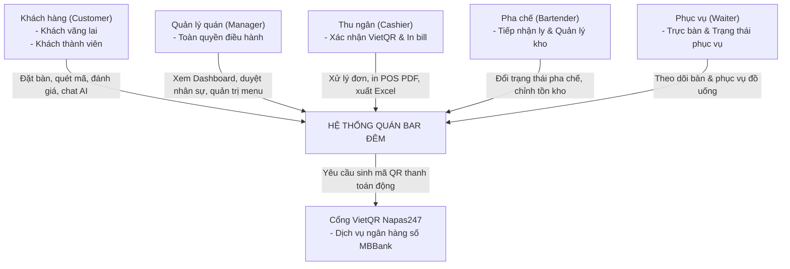

# 📋 GIAI ĐOẠN 1: PHÂN TÍCH YÊU CẦU (REQUIREMENT ANALYSIS SPECIFICATION)
## HỆ THỐNG QUẢN LÝ & ĐẶT BÀN QUÁN BAR ĐÊM (ARTISAN SPEAKEASY LOUNGE)

> **Môn học:** Lập trình Web / JavaScript Nâng Cao  
> **Tài liệu:** Báo cáo Giai đoạn 1 — Phân tích yêu cầu phần mềm  
> **Phiên bản:** 2.0.0

---

## 1. BỐI CẢNH & LÝ DO CHỌN ĐỀ TÀI

### 1.1. Bối cảnh thực tế
Mô hình quán bar nghệ thuật phong cách **Speakeasy Lounge** (không gian thưởng thức cocktail kín đáo, ánh sáng vàng ấm Noir & Champagne Gold, nhạc Jazz) đang phát triển mạnh mẽ tại các đô thị lớn. Tuy nhiên, phần lớn các quán hiện nay vẫn vận hành theo phương thức truyền thống:
- Khách gọi món trên menu giấy thô sơ, không biết rõ tỷ lệ nồng độ cồn (% ABV) hay hương vị đặc trưng (Tasting Notes) trước khi gọi.
- Đặt bàn qua tin nhắn mạng xã hội dễ bị trôi tin nhắn, trùng giờ hoặc không kiểm soát được lượng khách đến vào các khung giờ cao điểm (19:00 - 22:00).
- Khâu thanh toán chuyển khoản thủ công yêu cầu nhân viên phải chụp màn hình đối soát tài khoản, dễ nhầm lẫn hoặc gian lận.
- Việc kiểm soát nguyên liệu pha chế và số ly tồn kho hay bị sai lệch khi khách huỷ bàn hoặc đổi món đột xuất.

### 1.2. Mục tiêu của dự án
Xây dựng nền tảng website thương mại dịch vụ **Quán Bar Đêm** nhằm:
1. **Số hóa trải nghiệm khách hàng:** Giúp khách tra cứu thực đơn cocktail chuẩn quốc tế, nhận gợi ý từ Trợ lý Bartender ảo AI, đặt bàn trước theo khung giờ mong muốn, thanh toán tự động qua mã VietQR MBBank và nhận vé điện tử Bar Cinema Ticket có mã vạch định danh.
2. **Tối ưu hóa quản trị vận hành:** Cung cấp giải pháp POS phân quyền 4 vai trò nhân sự (Quản lý, Thu ngân, Pha chế, Phục vụ), máy trạng thái quản lý đơn hàng liên kết tự động hoàn trừ kho, báo cáo doanh thu trực quan trên Dashboard và xuất nhập dữ liệu Excel/PDF.

---

## 2. XÁC ĐỊNH CÁC TÁC TỬ HỆ THỐNG (SYSTEM ACTORS)

---

## 3. YÊU CẦU NGHIỆP VỤ (BUSINESS REQUIREMENTS - BR)

- **BR-01 (Quản lý thực đơn chuẩn hóa):** Mỗi món đồ uống phải có đầy đủ: tên thương phẩm, danh mục (Signature, Classic, Mocktail), giá tiền niêm yết, nồng độ cồn (% ABV), kiểu ly phục vụ, thẻ hương vị Tasting Notes và tỷ lệ công thức pha chế.
- **BR-02 (Ràng buộc tồn kho tức thời):** Không cho phép bán khống khi số ly trong kho bằng 0 (`stock = 0`). Món hết hàng phải hiển thị nhãn `Tạm hết món` (`soldout`).
- **BR-03 (Bảo toàn số lượng khi huỷ đơn):** Khi một đơn hàng ở trạng thái `pending` hoặc `preparing` bị huỷ (`cancelled`) hoặc xoá (`delete`), hệ thống phải tự động hoàn trả đầy đủ số lượng ly tương ứng về lại kho `/drinks`.
- **BR-04 (Bảo toàn doanh thu lịch sử):** Đối với các đơn hàng đã `completed` (hoàn tất phục vụ), khi xoá đơn tuyệt đối không được hoàn kho để tránh sai lệch báo cáo tài chính.
- **BR-05 (Thanh toán không tiền mặt tự động):** Tự động phát sinh mã QR chuyển khoản MBBank khớp chính xác số tài khoản quán, số tiền sau chiết khấu và nội dung chuyển khoản là mã đơn hàng.
- **BR-06 (Cấp vé điện tử định danh):** Mỗi đơn đặt bàn thành công phải được cấp một vé điện tử Bar Cinema Ticket kèm mã vạch Barcode SVG định danh lưu trong hòm thư `/emails`.
- **BR-07 (Phân quyền kiểm soát truy cập):** Mỗi nhân viên chỉ được phép truy cập vào các trang nghiệp vụ đúng với vai trò của mình theo ma trận RBAC.

---

## 4. YÊU CẦU NGƯỜI DÙNG (USER REQUIREMENTS - UR)

### 4.1. Dành cho Khách hàng (Customer)
- **UR-C01:** Tôi muốn tìm kiếm đồ uống theo tên, rượu nền hoặc hương vị để nhanh chóng tìm thấy ly cocktail ưng ý.
- **UR-C02:** Tôi muốn lọc cocktail theo nồng độ cồn (Không cồn, Nhẹ, Đậm) để phù hợp với thể trạng hoặc nhu cầu lái xe an toàn.
- **UR-C03:** Tôi muốn trò chuyện với Trợ lý Bartender ảo để được tư vấn món hợp khẩu vị ngay tại quầy.
- **UR-C04:** Tôi muốn thả tim lưu món vào danh sách Yêu thích để xem lại sau.
- **UR-C05:** Tôi muốn đánh giá 1-5 sao và để lại nhận xét công khai về chất lượng đồ uống.
- **UR-C06:** Tôi muốn đặt bàn trước, chọn ngày và bấm nút khung giờ nhanh (19:00, 20:00, 21:00...).
- **UR-C07:** Tôi muốn áp dụng mã giảm giá Voucher hoặc dùng điểm thưởng thành viên để giảm trừ trực tiếp trên Phiếu Đặt Chỗ.
- **UR-C08:** Tôi muốn quét mã VietQR MBBank trên app ngân hàng và nhận vé điện tử Bar Cinema Ticket.

### 4.2. Dành cho Nhân sự quán Bar (Staff)
- **UR-S01 (Thu ngân):** Tôi muốn nghe chuông âm thanh cảnh báo ngay khi có đơn hàng mới hoặc đơn vừa chuyển khoản thành công.
- **UR-S02 (Thu ngân):** Tôi muốn in hoá đơn nhiệt POS chuẩn 80mm PDF trực tiếp ra máy in để giao cho khách.
- **UR-S03 (Thu ngân / Quản lý):** Tôi muốn xuất toàn bộ dữ liệu đơn hàng ra file Excel tiếng Việt không bị lỗi font (UTF-8 BOM).
- **UR-S04 (Pha chế):** Tôi muốn theo dõi màn hình danh sách các ly cần làm và bấm nút chuyển trạng thái khi pha xong.
- **UR-S05 (Pha chế):** Tôi muốn điều chỉnh nhanh số lượng ly còn lại trong kho hoặc tạm ngưng bán món hết nguyên liệu.
- **UR-S06 (Quản lý):** Tôi muốn theo dõi biểu đồ doanh thu 7 ngày gần nhất, tỷ lệ loại đơn và top món bán chạy trên Dashboard.
- **UR-S07 (Quản lý):** Tôi muốn xét duyệt tài khoản nhân viên mới đăng ký và phân quyền chức vụ.
- **UR-S08 (Quản lý):** Tôi muốn nhập thực đơn hàng loạt từ file CSV để tiết kiệm thời gian nhập liệu thủ công.

---

## 5. YÊU CẦU PHI CHỨC NĂNG (NON-FUNCTIONAL REQUIREMENTS - NFR)

### 5.1. Hiệu năng & Trải nghiệm (Performance & UX)
- **Thời gian phản hồi:** Các thao tác lọc thực đơn, tìm kiếm và thêm giỏ hàng phải phản hồi tức thì (< 100ms).
- **Tốc độ khung hình:** Hiệu ứng nâng thẻ 3D, hover phát sáng và mở modal phải duy trì ổn định ở mức 60 FPS.
- **Tối ưu tài nguyên:** Áp dụng `loading="lazy"` trên 100% hình ảnh đồ uống; không sử dụng bất kỳ thư viện CSS/JS nặng nề nào ngoài các module ES6 tự viết.

### 5.2. Khả năng dự phòng & Ngoại tuyến (Resilience & Offline Capability)
- Khi mất kết nối máy chủ API tạm thời (`api.js` gặp lỗi), hệ thống phải tự động đọc từ bộ nhớ đệm `localStorage` gần nhất để giao diện không bị gián đoạn (Graceful Offline Degradation).

### 5.3. Tính tương thích & Responsive (Compatibility)
- Hoạt động mượt mà trên tất cả các trình duyệt hiện đại: Chrome, Edge, Safari, Firefox.
- Thích ứng hoàn hảo trên 3 cấp độ màn hình:
  - Mobile (< 768px): Menu trượt Drawer, bảng dữ liệu cuộn ngang cảm ứng, nút bấm to vừa ngón tay cái.
  - Tablet (768px - 1024px): Bố cục lưới 2 cột, bảng biểu tự co giãn.
  - Desktop (> 1024px): Toàn bộ không gian Speakeasy 3D Parallax, thanh điều hướng ngang sang trọng, cột phiếu đặt chỗ ghim dính (`sticky`).

### 5.4. Yêu cầu bảo mật (Security Requirements)
- **Chống XSS:** 100% dữ liệu nhập từ phía người dùng (tên khách, nội dung đánh giá, liên hệ) phải được làm sạch qua hàm `escapeHtml()`.
- **Cô lập phiên đăng nhập:** Phiên làm việc của nhân viên bắt buộc lưu trên `sessionStorage` để tự động xoá sạch khi đóng tab trình duyệt, tránh việc nhân viên ca sau truy cập trái phép vào quyền quản trị.
- **Bảo mật phạm vi Chatbot:** Chatbot tuyệt đối chỉ trả lời trong phạm vi quán bar, chặn 100% câu hỏi ngoài lề (toán học, code, thời tiết...).

---

## 6. MA TRẬN TRUY VẾT YÊU CẦU (REQUIREMENT TRACEABILITY MATRIX - RTM)

| Mã yêu cầu | Mô tả tóm tắt | Phân hệ | File mã nguồn triển khai | File kiểm thử tự động |
|---|---|:---:|---|---|
| **BR-01 / UR-C01** | Lọc thực đơn & nồng độ ABV | Khách hàng | `menu.html`, `menu.js`, `drinksService.js` | `kiem-tra-toan-dien.js` |
| **BR-02 / BR-03** | Trừ kho khi đặt, hoàn kho khi huỷ | Quản trị / Kho | `ordersService.js`, `drinksService.js` | `kiem-tra-ton-kho.js` (Test 1, 3, 5) |
| **BR-04** | Đơn hoàn tất không hoàn kho | Quản trị / Kho | `ordersService.js` | `kiem-tra-ton-kho.js` (Test 6, 15) |
| **BR-05 / UR-C08** | Thanh toán VietQR MBBank | Khách hàng | `vietqrService.js`, `order.js` | `kiem-tra-toan-dien.js` (Test 4) |
| **BR-06** | Vé điện tử Bar Cinema Ticket | Khách hàng | `emailService.js`, `order.js` | `kiem-tra-toan-dien.js` (Test 4) |
| **BR-07 / UR-S07** | Phân quyền vai trò RBAC | Quản trị | `staffAuth.js`, `adminLayout.js` | `kiem-tra-ton-kho.js` (Test 18) |
| **UR-C03 / NFR-Sec**| Trợ lý ảo AI bảo vệ phạm vi | Khách hàng | `chatbotService.js`, `chatbot.js` | `test-chatbot.js` (36 ca test) |
| **UR-S01** | Chuông Web Audio thời gian thực | Quản trị | `notificationService.js` | `kiem-tra-ton-kho.js` (Test 19) |
| **UR-S02 / UR-S03**| In POS PDF & Xuất Excel UTF-8 | Quản trị | `exportService.js` | `kiem-tra-ton-kho.js` (Test 19) |

---
*Tài liệu thuộc bộ hồ sơ kỹ thuật đồ án Quán Bar Đêm.*

