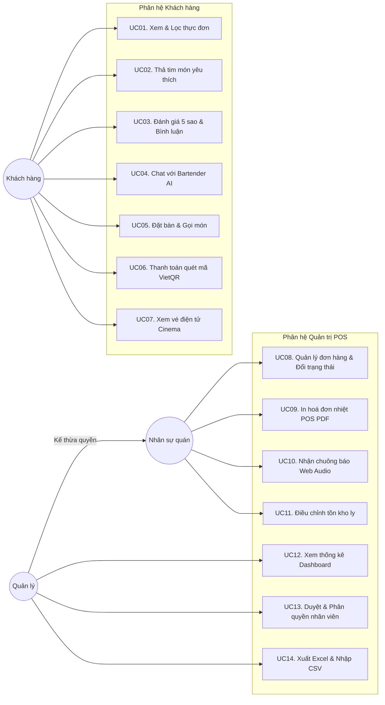

# ⚙️ GIAI ĐOẠN 2: XÁC ĐỊNH CHỨC NĂNG (FEATURE SPECIFICATION & USE CASES)
## HỆ THỐNG QUẢN LÝ & ĐẶT BÀN QUÁN BAR ĐÊM (ARTISAN SPEAKEASY LOUNGE)

> **Môn học:** Lập trình Web / JavaScript Nâng Cao  
> **Tài liệu:** Báo cáo Giai đoạn 2 — Đặc tả chức năng & Mô hình Use Case  
> **Phiên bản:** 2.0.0

---

## 1. BẢNG PHÂN RÃ CHỨC NĂNG HỆ THỐNG (FUNCTIONAL DECOMPOSITION)

Hệ thống **Quán Bar Đêm** bao gồm **2 phân hệ cốt lõi** với tổng cộng **21 chức năng cụ thể**:

```
HỆ THỐNG WEBSITE QUÁN BAR ĐÊM
│
├── [PHÂN HỆ KHÁCH HÀNG - CUSTOMER PORTAL]
│   ├── F01. Tra cứu thực đơn & Tìm kiếm đa tiêu chí (Tên, danh mục, ABV, hương vị)
│   ├── F02. Chi tiết ly cocktail (Công thức, loại ly, huy hiệu Signature/Best-seller)
│   ├── F03. Danh sách Cocktail yêu thích (Favorites - Thả tim động)
│   ├── F04. Đánh giá & Bình luận 5 sao trực tiếp trên từng món
│   ├── F05. Trợ lý Bartender ảo AI (Tư vấn theo vị & Chặn câu hỏi ngoài lề)
│   ├── F06. Đặt bàn & Gọi món trực quan (Bộ chọn Ngày & Nút giờ nhanh)
│   ├── F07. Thanh toán chuyển khoản tự động VietQR MBBank
│   ├── F08. Cấp phát vé điện tử Bar Cinema Ticket (Mã vạch Barcode SVG)
│   └── F09. Đăng nhập một cửa & Tích điểm thành viên (Đồng, Bạc, Vàng, Bạch kim)
│
└── [PHÂN HỆ QUẢN TRỊ POS & NHÂN SỰ - ADMIN BACK-OFFICE]
    ├── F10. Đăng nhập một cửa tự nhận diện nhân sự & Cô lập phiên sessionStorage
    ├── F11. Phân quyền vai trò RBAC 4 cấp (Quản lý, Thu ngân, Pha chế, Phục vụ)
    ├── F12. Quản lý vòng đời đơn hàng theo Máy trạng thái (FSM)
    ├── F13. Tự động trừ tồn kho khi đặt & Hoàn kho tự động khi huỷ/xoá đơn
    ├── F14. Chuông âm thanh Web Audio API cảnh báo đơn mới theo thời gian thực
    ├── F15. Bảng điều khiển kinh doanh (Dashboard trực quan hoá biểu đồ doanh thu)
    ├── F16. Quản trị danh mục thực đơn & điều chỉnh số tồn kho ly
    ├── F17. Quản trị nhân sự & xét duyệt tài khoản nhân viên mới tự đăng ký
    ├── F18. Quản trị mã giảm giá (Vouchers) & áp dụng mức giảm tự động
    ├── F19. In hóa đơn nhiệt POS 80mm PDF
    ├── F20. Xuất báo cáo Excel tiếng Việt chuẩn UTF-8 BOM
    └── F21. Nhập thực đơn hàng loạt bằng file CSV
```

---

## 2. SƠ ĐỒ USE CASE TỔNG QUAN (USE CASE DIAGRAM)



---

## 3. MA TRẬN PHÂN QUYỀN VAI TRÒ ĐỐI VỚI CHỨC NĂNG (RBAC FUNCTIONAL MATRIX)

| Mã CN | Tên chức năng | Khách hàng | Phục vụ | Pha chế | Thu ngân | Quản lý |
|:---:|---|:---:|:---:|:---:|:---:|:---:|
| **F01-F02** | Xem thực đơn, chi tiết ly cocktail | ✅ Có | ✅ Có | ✅ Có | ✅ Có | ✅ Có |
| **F03-F04** | Yêu thích, Đánh giá 5 sao | ✅ Có | ❌ | ❌ | ❌ | ❌ |
| **F05** | Chat với Trợ lý Bartender ảo AI | ✅ Có | ❌ | ❌ | ❌ | ❌ |
| **F06-F08** | Đặt bàn, Quét VietQR, Xem vé điện tử | ✅ Có | ❌ | ❌ | ❌ | ❌ |
| **F09** | Tích điểm, nâng hạng thành viên | ✅ Có | ❌ | ❌ | ❌ | ❌ |
| **F10-F11** | Đăng nhập một cửa & Phân quyền RBAC | ✅ Có | ✅ Có | ✅ Có | ✅ Có | ✅ Có |
| **F12-F13** | Quản lý đơn hàng & Máy trạng thái hoàn kho | ❌ | 👁️ Chỉ xem | 🍸 Pha chế | 💰 Duyệt/In | 👑 Toàn quyền |
| **F14** | Chuông Web Audio cảnh báo đơn mới | ❌ | ✅ Có | ✅ Có | ✅ Có | ✅ Có |
| **F15** | Dashboard thống kê doanh thu | ❌ | ❌ | ❌ | ❌ | 👑 Toàn quyền |
| **F16** | Quản trị thực đơn & Tồn kho ly | ❌ | ❌ | 🍸 Chỉnh kho | ❌ | 👑 Toàn quyền |
| **F17** | Quản trị nhân sự & Duyệt nhân viên mới | ❌ | ❌ | ❌ | ❌ | 👑 Toàn quyền |
| **F18** | Quản trị mã giảm giá (Vouchers) | ❌ | ❌ | ❌ | ❌ | 👑 Toàn quyền |
| **F19** | In hóa đơn nhiệt POS 80mm PDF | ❌ | ❌ | ❌ | 💰 In bill | 👑 Toàn quyền |
| **F20** | Xuất báo cáo Excel UTF-8 BOM | ❌ | ❌ | ❌ | 💰 Xuất file | 👑 Toàn quyền |
| **F21** | Nhập thực đơn hàng loạt bằng CSV | ❌ | ❌ | ❌ | ❌ | 👑 Toàn quyền |

---

## 4. ĐẶC TẢ CHI TIẾT CÁC USE CASE TIÊU BIỂU

### 4.1. Use Case UC05: Đặt bàn & Gọi món (Khách hàng)
- **Tác tử chính:** Khách hàng (Customer).
- **Mục đích:** Đặt giữ bàn trước tại quán theo ngày giờ mong muốn và chọn các ly cocktail yêu thích.
- **Tiền điều kiện:** Khách truy cập vào trang `order.html`.
- **Luồng sự kiện chính (Main Flow):**
  1. Khách hàng chọn loại hình đặt bàn (`Booking`).
  2. Khách chọn Ngày hẹn đến từ bộ chọn ngày thông minh (không cho chọn ngày trong quá khứ, tối đa 30 ngày).
  3. Khách bấm nút chọn nhanh một khung giờ đón khách (`19:00`, `20:00`, `21:00`...).
  4. Khách chọn vị trí khu vực bàn (Quầy Bar, Khu Sofa, Góc riêng tư) và nhập số lượng khách.
  5. Hệ thống hiển thị các món đã có trong giỏ hàng; khách có thể tăng giảm số lượng (tối đa bằng tồn kho).
  6. Khách nhập mã giảm giá Voucher hoặc đăng nhập thành viên để dùng điểm tích luỹ.
  7. Phiếu Đặt Chỗ (Reservation Slip) tự động cập nhật số tiền tạm tính, số tiền giảm và số tiền thực thanh toán.
  8. Khách nhập họ tên, số điện thoại, email và bấm nút *"Xác nhận đặt bàn"*.
  9. Hệ thống gửi yêu cầu tạo đơn, tự động trừ số lượng tồn kho tương ứng của các món và chuyển sang bước thanh toán.
- **Hậu điều kiện:** Đơn hàng được tạo ở trạng thái `pending`, tồn kho trong bảng `/drinks` giảm đi tương ứng.

---

### 4.2. Use Case UC06: Thanh toán chuyển khoản tự động VietQR MBBank
- **Tác tử chính:** Khách hàng (Customer), Cổng VietQR Napas247 (MBBank).
- **Mục đích:** Thanh toán tiền đơn hàng nhanh chóng, không dùng tiền mặt qua mã QR ngân hàng số.
- **Tiền điều kiện:** Đơn hàng đã được tạo thành công với hình thức `vietqr`.
- **Luồng sự kiện chính:**
  1. Hệ thống tự động kích hoạt dịch vụ `vietqrService.js`.
  2. Tạo liên kết mã QR động khớp chính xác: Số tài khoản MBBank, Tên chủ tài khoản, Số tiền thực thanh toán và Nội dung chuyển khoản là Mã đơn hàng (VD: `DH0010`).
  3. Mở cửa sổ Modal VietQR MBBank với hình ảnh mã QR sắc nét và đồng hồ đếm ngược 10 phút.
  4. Khách mở ứng dụng ngân hàng trên điện thoại (MBBank, Vietcombank, Techcombank, MoMo...) và quét mã.
  5. Khách xác nhận chuyển tiền thành công trên ứng dụng ngân hàng và bấm nút *"Tôi đã chuyển khoản"* trên website.
  6. Hệ thống cập nhật trạng thái đơn hàng thành `paymentStatus = 'paid'`.
  7. Tự động sinh vé Bar Cinema Ticket (Barcode SVG định danh) lưu vào hòm thư `/emails`.
  8. Phát chuông thông báo và chuyển hướng khách sang trang chi tiết vé.

---

### 4.3. Use Case UC08: Quản lý vòng đời đơn hàng & Hoàn trừ kho (Quản trị POS)
- **Tác tử chính:** Quản lý quán (Manager), Thu ngân (Cashier), Pha chế (Bartender).
- **Mục đích:** Theo dõi và chuyển đổi trạng thái đơn hàng theo đúng chu trình pha chế và phục vụ tại quán.
- **Tiền điều kiện:** Nhân viên đã đăng nhập và mở trang `admin-orders.html`.
- **Luồng sự kiện chính:**
  1. Khi có đơn hàng mới, chuông Web Audio API tự động phát âm thanh sang trọng báo hiệu.
  2. Thu ngân bấm duyệt đơn hàng: Chuyển trạng thái từ `Chờ xử lý (pending)` ➔ `Đang pha chế (preparing)`.
  3. Nhân viên Pha chế quan sát danh sách, pha xong các ly cocktail ➔ Bấm chuyển sang `Đang phục vụ (serving)`.
  4. Nhân viên Phục vụ mang đồ uống ra bàn cho khách.
  5. Khi khách thưởng thức xong và rời quán, Thu ngân bấm chuyển sang `Hoàn tất (completed)`.
- **Luồng ngoại lệ (Huỷ đơn hoàn kho):**
  - Nếu khách huỷ đơn khi đơn đang ở trạng thái `pending` hoặc `preparing`: Thu ngân bấm *"Huỷ đơn"*.
  - Hệ thống tự động duyệt qua toàn bộ các ly cocktail trong đơn và cộng hoàn trả đầy đủ số lượng vào kho `/drinks`. Món bị hết hàng (`soldout`) sẽ tự động mở bán lại thành `available`.

---
*Tài liệu thuộc bộ hồ sơ kỹ thuật đồ án Quán Bar Đêm.*

