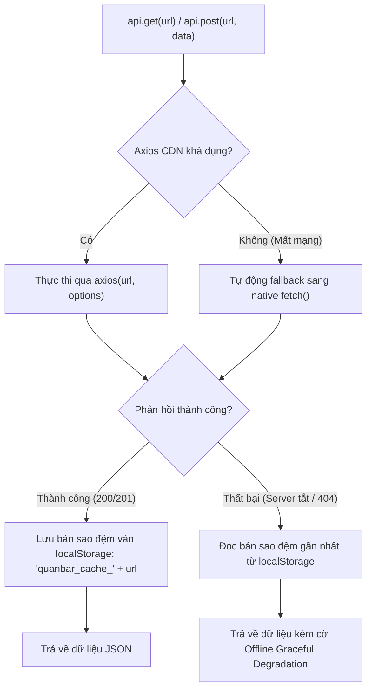

# 🌐 TÀI LIỆU ĐẶC TẢ THIẾT KẾ RESTFUL API (API SPECIFICATION)
## HỆ THỐNG QUẢN LÝ & ĐẶT BÀN QUÁN BAR ĐÊM (ARTISAN SPEAKEASY LOUNGE)

> **Môn học:** Lập trình Web / JavaScript Nâng Cao  
> **Tài liệu:** Bài tập 4 — Thiết kế API (RESTful Endpoints Design)  
> **Giao thức:** HTTP/1.1 (JSON over HTTP)  
> **Base URL:** `http://localhost:3000`  
> **Content-Type:** `application/json; charset=utf-8`  
> **CORS:** Kích hoạt toàn cục (`Access-Control-Allow-Origin: *`)

---

## MỤC LỤC TÀI LIỆU API

1. [Quy chuẩn chung & Mã phản hồi HTTP (HTTP Status Codes)](#1-quy-chuẩn-chung--mã-phản-hồi-http)
2. [Tài nguyên Thực đơn & Đồ uống (`/drinks`)](#2-tài-nguyên-thực-đơn--đồ-uống-drinks)
3. [Tài nguyên Đơn hàng & Đặt bàn (`/orders`)](#3-tài-nguyên-đơn-hàng--đặt-bàn-orders)
4. [Tài nguyên Khách hàng thành viên (`/customers`)](#4-tài-nguyên-khách-hàng-thành-viên-customers)
5. [Tài nguyên Nhân sự quán Bar (`/staff`)](#5-tài-nguyên-nhân-sự-quán-bar-staff)
6. [Tài nguyên Mã giảm giá (`/vouchers`)](#6-tài-nguyên-mã-giảm-giá-vouchers)
7. [Tài nguyên Đánh giá & Bình luận (`/reviews`)](#7-tài-nguyên-đánh-giá--bình-luận-reviews)
8. [Tài nguyên Vé điện tử & Hòm thư (`/emails`)](#8-tài-nguyên-vé-điện-tử--hòm-thư-emails)
9. [Tài nguyên Hộp thư liên hệ (`/messages`)](#9-tài-nguyên-hộp-thư-liên-hệ-messages)
10. [Tài nguyên Cấu hình hệ thống & VietQR (`/settings`)](#10-tài-nguyên-cấu-hình-hệ-thống--vietqr-settings)
11. [Tích hợp Cổng thanh toán VietQR MBBank](#11-tích-hợp-cổng-thanh-toán-vietqr-mbbank)
12. [Cơ chế Adapter dự phòng ngoại tuyến trong `api.js`](#12-cơ-chế-adapter-dự-phòng-ngoại-tuyến)

---

## 1. QUY CHUẨN CHUNG & MÃ PHẢN HỒI HTTP

### 1.1. Bảng mã trạng thái HTTP (HTTP Status Codes)

| Mã trạng thái | Tên mã | Ý nghĩa & Ứng dụng |
|:---:|---|---|
| `200 OK` | Thành công | Yêu cầu `GET`, `PATCH`, `DELETE` được thực thi hoàn tất. |
| `201 Created` | Đã tạo mới | Yêu cầu `POST` tạo mới bản ghi thành công (Đơn hàng, Món mới, Đánh giá...). |
| `204 No Content` | Không có nội dung | Thực thi thao tác xoá hoặc cập nhật không cần trả về dữ liệu. |
| `400 Bad Request` | Yêu cầu không hợp lệ | Thiếu trường bắt buộc, sai định dạng dữ liệu hoặc vi phạm ràng buộc tồn kho. |
| `401 Unauthorized` | Chưa xác thực | Chưa đăng nhập hoặc tài khoản không tồn tại. |
| `403 Forbidden` | Bị từ chối quyền | Nhân viên không đủ thẩm quyền truy cập (theo ma trận RBAC). |
| `404 Not Found` | Không tìm thấy | Bản ghi theo ID hoặc đường dẫn API không tồn tại trên hệ thống. |
| `500 Server Error` | Lỗi máy chủ | Lỗi đọc ghi tệp `db.json` hoặc máy chủ REST API bị treo. |

---

## 2. TÀI NGUYÊN THỰC ĐƠN & ĐỒ UỐNG (`/drinks`)

### 2.1. Lấy danh sách đồ uống (GET `/drinks`)
- **Mô tả:** Lấy toàn bộ thực đơn hoặc lọc theo danh mục, trạng thái, nồng độ ABV, sắp xếp.
- **Query Parameters:**
  - `category` *(tuỳ chọn)*: `signature` | `classic` | `mocktail` | `beer`
  - `status` *(tuỳ chọn)*: `available` | `soldout`
  - `featured` *(tuỳ chọn)*: `true` (chỉ lấy món đặc tuyển)
  - `_sort`: `price` | `rating` | `name`
  - `_order`: `asc` | `desc`
  - `q`: Từ khóa tìm kiếm toàn văn theo tên hoặc thành phần.

- **Ví dụ Request:**
  ```http
  GET /drinks?category=signature&_sort=price&_order=asc HTTP/1.1
  Host: localhost:3000
  ```

- **Ví dụ Response (`200 OK`):**
  ```json
  [
    {
      "id": "d1",
      "name": "Negroni Speakeasy",
      "category": "signature",
      "price": 145000,
      "abv": 24.0,
      "stock": 15,
      "status": "available",
      "featured": true,
      "rating": 4.9,
      "glassType": "Rocks Glass",
      "image": "img/drinks/negroni.jpg",
      "tasteNotes": ["Đậm đà", "Đắng thảo mộc", "Vỏ cam ấm"],
      "recipe": "30ml Gin, 30ml Campari, 30ml Sweet Vermouth"
    }
  ]
  ```

### 2.2. Lấy chi tiết 1 ly cocktail (GET `/drinks/:id`)
- **Ví dụ Request:** `GET /drinks/d1`
- **Response:** Trả về đối tượng JSON của món hoặc `404 Not Found` nếu sai ID.

### 2.3. Thêm món mới vào thực đơn (POST `/drinks`)
- **Quyền hạn:** Chỉ **Quản lý (Manager)** mới được thực hiện.
- **Request Body (JSON):**
  ```json
  {
    "name": "Smoked Boulevardier",
    "category": "signature",
    "price": 165000,
    "abv": 28.5,
    "stock": 20,
    "status": "available",
    "featured": true,
    "glassType": "Coupe",
    "image": "img/drinks/boulevardier.jpg",
    "tasteNotes": ["Khói gỗ sồi", "Ngọt ngào Bourbon", "Thảo mộc"],
    "recipe": "45ml Bourbon, 30ml Campari, 30ml Sweet Vermouth"
  }
  ```
- **Response (`201 Created`):** Trả về đối tượng vừa tạo kèm `id` tự sinh từ máy chủ.

### 2.4. Cập nhật món (PATCH `/drinks/:id`)
- **Request Body:** Cập nhật từng phần (VD: đổi giá hoặc chỉnh số tồn kho):
  ```json
  {
    "price": 155000,
    "stock": 12
  }
  ```
- **Response (`200 OK`):** Trả về đối tượng sau khi cập nhật.

### 2.5. Xoá món khỏi thực đơn (DELETE `/drinks/:id`)
- **Response (`200 OK`):** `{}`.

---

## 3. TÀI NGUYÊN ĐƠN HÀNG & ĐẶT BÀN (`/orders`)

### 3.1. Lấy danh sách đơn đặt bàn (GET `/orders`)
- **Query Parameters:**
  - `status`: `pending` | `preparing` | `serving` | `completed` | `cancelled`
  - `customerPhone`: Lọc theo số điện thoại khách đặt.
  - `orderType`: `booking` | `dine_in` | `takeaway`
  - `_sort`: `createdAt`, `_order`: `desc`

- **Ví dụ Response (`200 OK`):**
  ```json
  [
    {
      "id": "DH0009",
      "orderCode": "DH0009",
      "customerName": "Lê Hoàng Minh",
      "customerPhone": "0912345678",
      "customerEmail": "hoangminh@gmail.com",
      "orderType": "booking",
      "bookingDate": "2026-11-06",
      "bookingTimeSlot": "20:00",
      "tableType": "bar",
      "guests": 2,
      "items": [
        { "drinkId": "d1", "name": "Negroni Speakeasy", "price": 145000, "quantity": 2 }
      ],
      "status": "pending",
      "paymentMethod": "vietqr",
      "paymentStatus": "paid",
      "subtotal": 290000,
      "discount": 29000,
      "total": 261000,
      "createdAt": "2026-11-05T13:30:00.000Z"
    }
  ]
  ```

### 3.2. Tạo đơn đặt bàn mới (POST `/orders`)
- **Mô tả:** Khách hàng hoặc Thu ngân tạo đơn mới. Khi gọi hàm này, hệ thống client tự động kết hợp gửi các lệnh cập nhật giảm trừ tồn kho trong `/drinks`.
- **Request Body:**
  ```json
  {
    "customerName": "Nguyễn Văn A",
    "customerPhone": "0909123456",
    "customerEmail": "vana@gmail.com",
    "orderType": "booking",
    "bookingDate": "2026-11-08",
    "bookingTimeSlot": "21:00",
    "tableType": "sofa",
    "guests": 4,
    "items": [
      { "drinkId": "d1", "name": "Negroni Speakeasy", "price": 145000, "quantity": 2 },
      { "drinkId": "d2", "name": "Old Fashioned", "price": 135000, "quantity": 1 }
    ],
    "status": "pending",
    "paymentMethod": "vietqr",
    "paymentStatus": "unpaid",
    "subtotal": 425000,
    "discount": 0,
    "total": 425000,
    "createdAt": "2026-11-05T13:40:00.000Z"
  }
  ```
- **Response (`201 Created`):** Đối tượng Order đầy đủ kèm ID máy chủ sinh ra (VD: `"id": "DH0010"`).

### 3.3. Cập nhật trạng thái đơn & Thanh toán (PATCH `/orders/:id`)
- **Mô tả:** Chuyển đổi trạng thái máy (State Machine) hoặc cập nhật thanh toán VietQR thành công:
  ```json
  {
    "status": "preparing",
    "paymentStatus": "paid"
  }
  ```
- **Response (`200 OK`):** Trả về đơn hàng với trạng thái mới.

### 3.4. Xoá đơn hàng (DELETE `/orders/:id`)
- **Mô tả:** Nếu đơn đang ở trạng thái `pending` hoặc `preparing`, hệ thống client tự động gọi bù tồn kho trước khi xoá.

---

## 4. TÀI NGUYÊN KHÁCH HÀNG THÀNH VIÊN (`/customers`)

### 4.1. Tra cứu tài khoản khách (GET `/customers`)
- **Query Parameters:** `?phone=0901234567` hoặc `?email=khach@gmail.com`
- **Ví dụ Response (`200 OK`):**
  ```json
  [
    {
      "id": "c1",
      "name": "Trần Thị Mai",
      "phone": "0901234567",
      "email": "mai.tran@gmail.com",
      "tier": "gold",
      "points": 350,
      "totalSpent": 3500000,
      "avatar": "img/avatars/avatar-1.jpg"
    }
  ]
  ```

### 4.2. Đăng ký khách hàng mới (POST `/customers`)
- **Request Body:** `{ name, phone, email, passwordHash, tier: "bronze", points: 0, totalSpent: 0 }`
- **Response (`201 Created`)**

### 4.3. Cập nhật thông tin khách (PATCH `/customers/:id`)
- **Ví dụ:** Cập nhật ảnh đại diện, đổi mật khẩu hoặc tích luỹ điểm thưởng:
  ```json
  {
    "avatar": "data:image/png;base64,...",
    "points": 400
  }
  ```

---

## 5. TÀI NGUYÊN NHÂN SỰ QUÁN BAR (`/staff`)

### 5.1. Lấy danh sách nhân sự (GET `/staff`)
- **Query Parameters:** `?role=cashier` hoặc `?status=pending`

### 5.2. Nhân viên tự đăng ký (POST `/staff`)
- **Mô tả:** Nhân viên đăng ký tại `admin-register.html`. Trạng thái luôn bị ép thành `pending` (chờ duyệt):
  ```json
  {
    "code": "NV05",
    "name": "Phạm Quốc Bảo",
    "phone": "0933445566",
    "role": "bartender",
    "shift": "evening",
    "status": "pending",
    "passwordHash": "..."
  }
  ```

### 5.3. Quản lý phê duyệt & Phân quyền (PATCH `/staff/:id`)
- **Request Body:** Phê duyệt nhân viên vào làm việc:
  ```json
  {
    "status": "active",
    "role": "cashier"
  }
  ```

---

## 6. TÀI NGUYÊN MÃ GIẢM GIÁ (`/vouchers`)

### 6.1. Kiểm tra mã giảm giá (GET `/vouchers?code={code}`)
- **Ví dụ:** `GET /vouchers?code=SPEAKEASY20`
- **Response (`200 OK`):**
  ```json
  [
    {
      "id": "v1",
      "code": "SPEAKEASY20",
      "discountPercent": 20,
      "maxDiscount": 50000,
      "minOrder": 200000,
      "expiryDate": "2026-12-31",
      "usedCount": 14
    }
  ]
  ```

---

## 7. TÀI NGUYÊN ĐÁNH GIÁ & BÌNH LUẬN (`/reviews`)

### 7.1. Lấy bình luận của món (GET `/reviews?drinkId={id}`)
- **Ví dụ:** `GET /reviews?drinkId=d1&_sort=createdAt&_order=desc`

### 7.2. Gửi đánh giá sao mới (POST `/reviews`)
- **Request Body:**
  ```json
  {
    "drinkId": "d1",
    "customerName": "Hoàng Nam",
    "rating": 5,
    "comment": "Ly Negroni pha rất chuẩn vị, đắng ấm thảo mộc cực kỳ thư giãn!",
    "createdAt": "2026-11-05T13:42:00.000Z"
  }
  ```
- **Response (`201 Created`)**

---

## 8. TÀI NGUYÊN VÉ ĐIỆN TỬ & HÒM THƯ (`/emails`)

### 8.1. Lấy danh sách vé đã phát hành (GET `/emails`)
- **Query Parameters:** `?orderId=DH0009`

### 8.2. Lưu cuống vé điện tử Cinema Bar Ticket (POST `/emails`)
- **Request Body:**
  ```json
  {
    "orderId": "DH0009",
    "recipient": "hoangminh@gmail.com",
    "subject": "Vé Điện Tử Xác Nhận Đặt Bàn — Quán Bar Đêm (DH0009)",
    "barcode": "QBD-20261105-DH0009",
    "ticketHtml": "<div class='cinema-ticket-card'>...</div>",
    "sentAt": "2026-11-05T13:30:05.000Z"
  }
  ```

---

## 9. TÀI NGUYÊN HỘP THƯ LIÊN HỆ (`/messages`)

### 9.1. Gửi tin nhắn liên hệ / Đặt tiệc (POST `/messages`)
- **Request Body:**
  ```json
  {
    "name": "Công ty ABC",
    "email": "contact@abc.com",
    "subject": "Đặt tiệc riêng tư cuối tuần",
    "message": "Chúng tôi muốn bao trọn khu vực Sofa cho 15 người tối thứ Bảy.",
    "status": "unread",
    "createdAt": "2026-11-05T13:00:00.000Z"
  }
  ```

---

## 10. TÀI NGUYÊN CẤU HÌNH HỆ THỐNG & VIETQR (`/settings`)

### 10.1. Lấy thông tin cấu hình (GET `/settings`)
- **Response (`200 OK`):**
  ```json
  {
    "id": 1,
    "bankId": "MBBANK",
    "accountNo": "0334808381",
    "accountName": "QUAN BAR DEM SPEAKEASY",
    "openHours": "18:00 - 02:00",
    "hotline": "0901 234 567",
    "address": "74-76 Nam Kỳ Khởi Nghĩa, Bến Nghé, Quận 1, TP. Hồ Chí Minh"
  }
  ```

### 10.2. Quản lý cập nhật số tài khoản nhận tiền (PATCH `/settings`)
- **Quyền hạn:** Chỉ duy nhất Quản lý được phép sửa tài khoản ngân hàng.

---

## 11. TÍCH HỢP CỔNG THANH TOÁN VIETQR MBBANK

Hệ thống tích hợp cổng thanh toán trực tiếp qua định dạng chuẩn **Napas247 QuickLink**:

### Cấu trúc URL sinh mã QR động:
```
https://img.vietqr.io/image/{bankId}-{accountNo}-compact2.png?amount={total}&addInfo={orderCode}&accountName={accountName}
```
- **Tham số truyền động:**
  - `{bankId}`: `MBBANK` (Ngân hàng Quân Đội).
  - `{accountNo}`: Số tài khoản cấu hình trong `/settings`.
  - `{total}`: Số tiền thực thanh toán sau khi trừ Voucher (VNĐ).
  - `{orderCode}`: Mã đơn hàng (VD: `DH0009`) dùng làm nội dung chuyển khoản để đối soát tự động.

---

## 12. CƠ CHẾ ADAPTER DỰ PHÒNG NGOẠI TUYẾN (`api.js`)

Để đảm bảo hệ thống không bao giờ bị sập giao diện khi máy chủ tắt hoặc mạng chập chờn:



---
*Tài liệu thuộc bộ hồ sơ kỹ thuật đồ án Quán Bar Đêm.*

