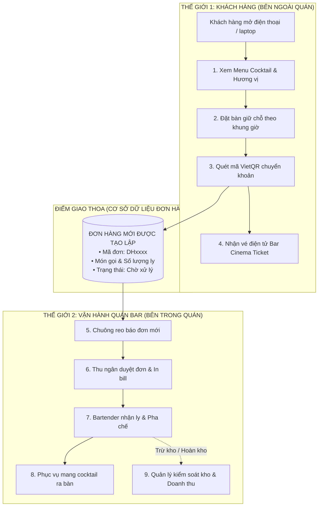
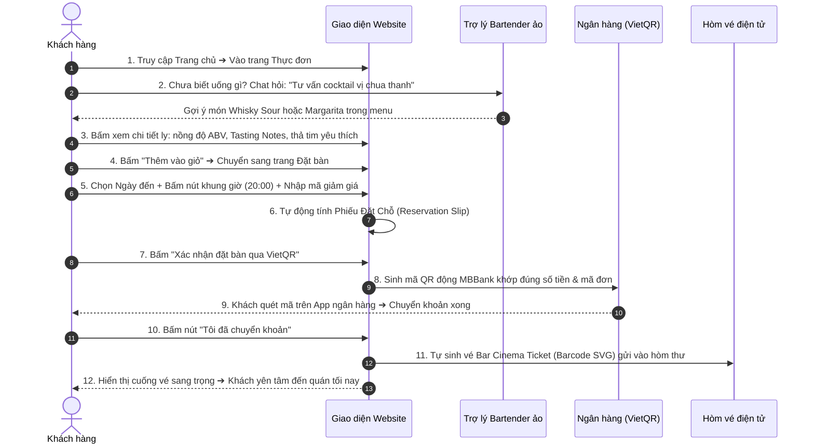
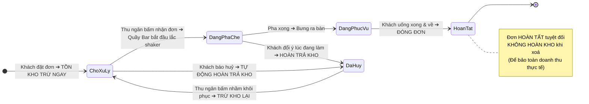
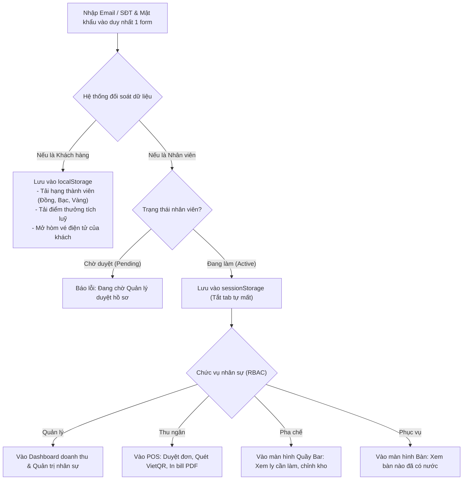

# 🎨 BẢN THIẾT KẾ WORKFLOW TỪ CON SỐ 0 (DAY 0 BLUEPRINT)
## HỆ THỐNG QUẢN LÝ & ĐẶT BÀN QUÁN BAR ĐÊM (ARTISAN SPEAKEASY LOUNGE)

> **Tình huống giả định:** Hệ thống chưa hề tồn tại, chưa có một dòng code, chưa có `db.json`.  
> **Mục tiêu:** Là một Kỹ sư phần mềm / Solution Architect, ngồi xuống với một tờ giấy trắng để vẽ toàn bộ luồng nghiệp vụ (Workflow) từ con số 0, từ đó mới bắt tay vào code và xây dựng nên đồ án này.

---

## 1. BƯỚC ĐẦU TIÊN: ĐỀ BÀI TỪ CHỦ QUÁN BAR (PROBLEM STATEMENT)

Chủ quán Bar Đêm đến gặp bạn và nói:
> *"Tôi muốn mở một quán Cocktail Bar Speakeasy cao cấp. Tôi muốn có một website để:*
> 1. *Khách lên mạng xem được thực đơn chuẩn quốc tế, biết nồng độ cồn ABV, hương vị, đặt trước bàn theo khung giờ tối, trả tiền quét mã QR ngân hàng và có vé điện tử vào cửa.*
> 2. *Quán tôi có Phục vụ, Pha chế, Thu ngân và tôi là Quản lý. Làm sao để khi khách đặt món thì kho rượu tự động trừ, nhân viên biết đường pha chế, thu ngân in được bill, không bị mất tiền và thất thoát tồn kho?"*

Từ bài toán trên, ta không vội mở máy tính lên code HTML/CSS ngay, mà phải **vẽ ra 4 sơ đồ Workflow cốt lõi** để định hình toàn bộ dự án.

---

## 2. WORKFLOW 1: BỨC TRANH TOÀN CẢNH (BIG PICTURE ARCHITECTURE)

Ta chia hệ thống thành **2 thế giới** gặp nhau ở **Chiếc Đơn Hàng & Vé Điện Tử**:

---

## 3. WORKFLOW 2: TRẢI NGHIỆM KHÁCH HÀNG TỪ A ĐẾN Z (CUSTOMER JOURNEY)

Ta vẽ chi tiết từng bước mà một vị khách sẽ trải qua trên website để biết mình cần làm những trang HTML nào:

---

## 4. WORKFLOW 3: THIẾT KẾ CỖ MÁY TRẠNG THÁI & BẢO VỆ TỒN KHO (STATE MACHINE & INVENTORY)

Đây là bài toán nghiệp vụ hóc búa nhất: **Làm sao để rượu không bị thất thoát khi khách huỷ bàn hoặc đổi ý?**

Ta vẽ ra quy tắc chuyển đổi trạng thái nghiêm ngặt trước khi viết code:

---

## 5. WORKFLOW 4: DÒNG CHẢY DỮ LIỆU ĐĂNG NHẬP & PHÂN QUYỀN (UNIFIED RBAC)

Ta không muốn làm 2 trang đăng nhập riêng biệt (quản trị riêng, khách riêng) vì người dùng sẽ bị rối.  
Ta vẽ ra luồng **"Đăng nhập một cửa thông minh"**:

---

## 6. BƯỚC ĐỘT PHÁ: TỪ WORKFLOW NÀY SUY RA MỌI THỨ CẦN LẬP TRÌNH!

Sau khi vẽ xong 4 sơ đồ Workflow trên, ta lập tức có câu trả lời rõ như ban ngày cho toàn bộ dự án:

### 1. Ta cần tạo những trang HTML nào? (Nhìn từ Workflow 1 & 2):
- Khách cần xem menu ➔ Cần file `menu.html` & `detail.html`.
- Khách cần đặt bàn ➔ Cần file `order.html`.
- Khách cần xem vé ➔ Cần file `customer-account.html`.
- Thu ngân cần xử lý đơn ➔ Cần file `admin-orders.html`.
- Quản lý cần xem biểu đồ ➔ Cần file `admin-dashboard.html`.
- Pha chế & quản lý cần kho ➔ Cần file `admin-menu.html`.
- Nhân viên cần tài khoản ➔ Cần file `admin-staff.html` & `admin-register.html`.

### 2. Ta cần tạo những bảng dữ liệu nào trong Database `db.json`?
- Để lưu menu cocktail ➔ Cần bảng `/drinks` (`name`, `price`, `abv`, `stock`, `tasteNotes`).
- Để lưu phiếu đặt bàn ➔ Cần bảng `/orders` (`customerName`, `bookingTimeSlot`, `items`, `status`).
- Để lưu vé điện tử ➔ Cần bảng `/emails` (`orderId`, `barcode`, `ticketHtml`).
- Để lưu tài khoản khách ➔ Cần bảng `/customers` (`phone`, `tier`, `points`).
- Để phân quyền nhân viên ➔ Cần bảng `/staff` (`role`, `shift`, `status`).
- Để áp dụng ưu đãi ➔ Cần bảng `/vouchers` (`code`, `discountPercent`).
- Để quét mã MBBank ➔ Cần bảng `/settings` (`accountNo`, `bankId`).

### 3. Ta cần viết những hàm JavaScript nào?
- Trừ kho, hoàn kho ➔ Viết trong `ordersService.js`.
- Sinh mã QR MBBank ➔ Viết trong `vietqrService.js`.
- Phát chuông khi có đơn mới ➔ Viết trong `notificationService.js` (Web Audio API).
- Vẽ vé rách Cinema có mã vạch ➔ Viết trong `emailService.js`.
- In hoá đơn 80mm PDF & Xuất Excel ➔ Viết trong `exportService.js`.

---

## 7. KẾT LUẬN

Đây chính là **phương pháp tư duy chuẩn mực của một Lập trình viên chuyên nghiệp**:  
> **"Không bao giờ code trước khi có Workflow. Hãy vẽ ra con đường của dữ liệu và con người trước, khi Workflow đã thông suốt thì việc viết code HTML/CSS/JS chỉ là bước hiện thực hoá bản vẽ đó thành hiện thực!"**
