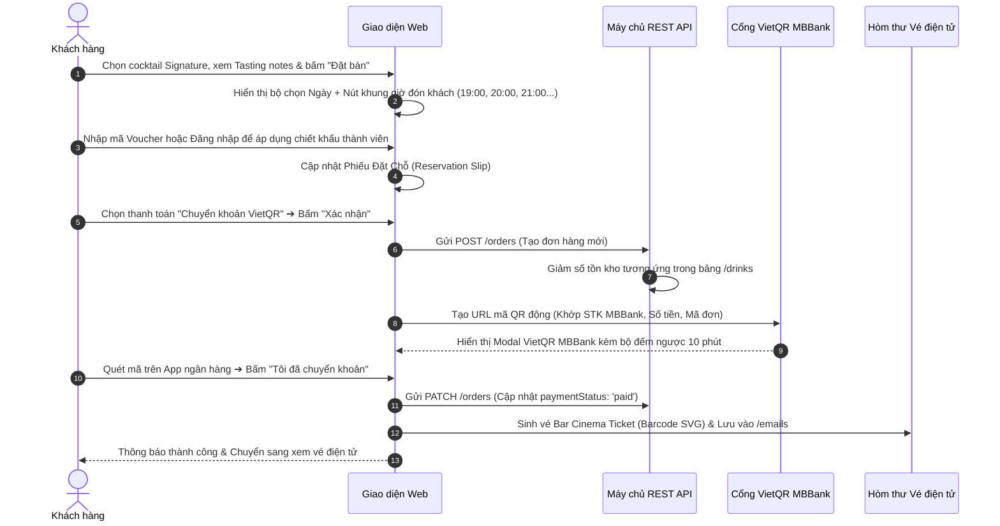
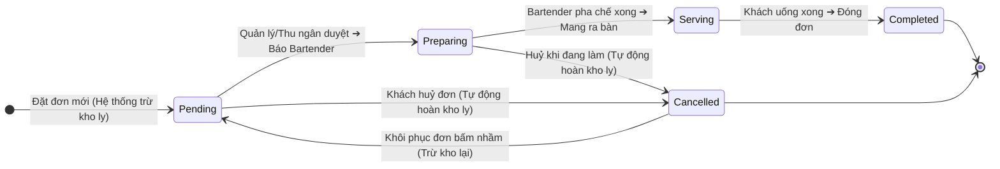
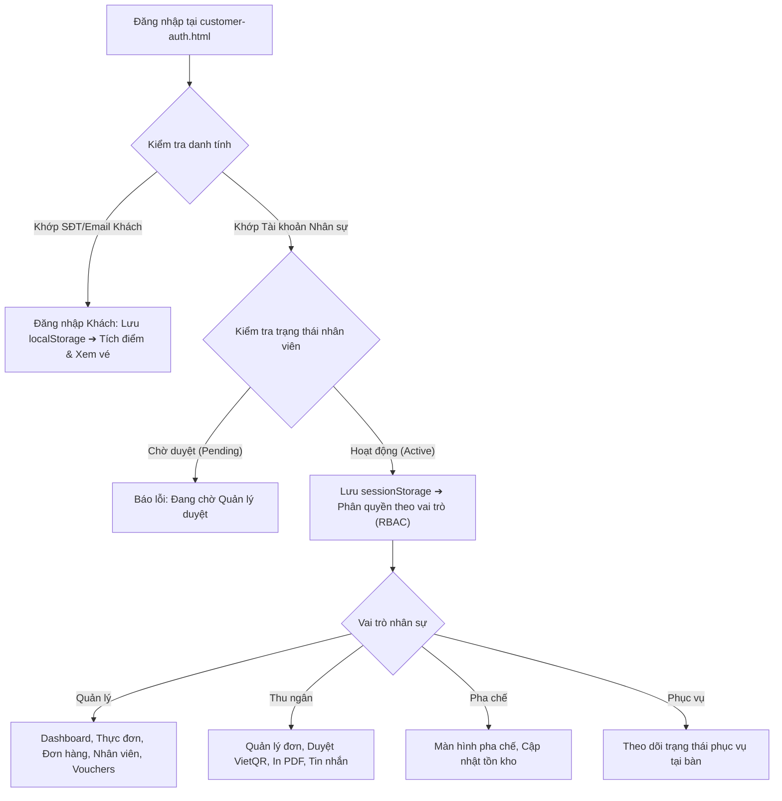
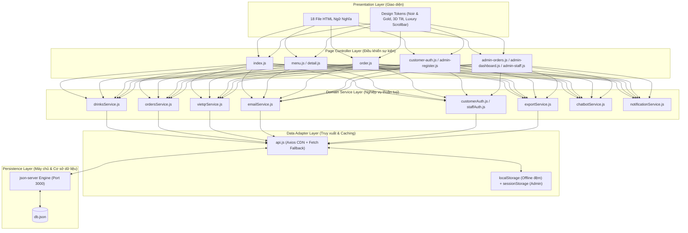
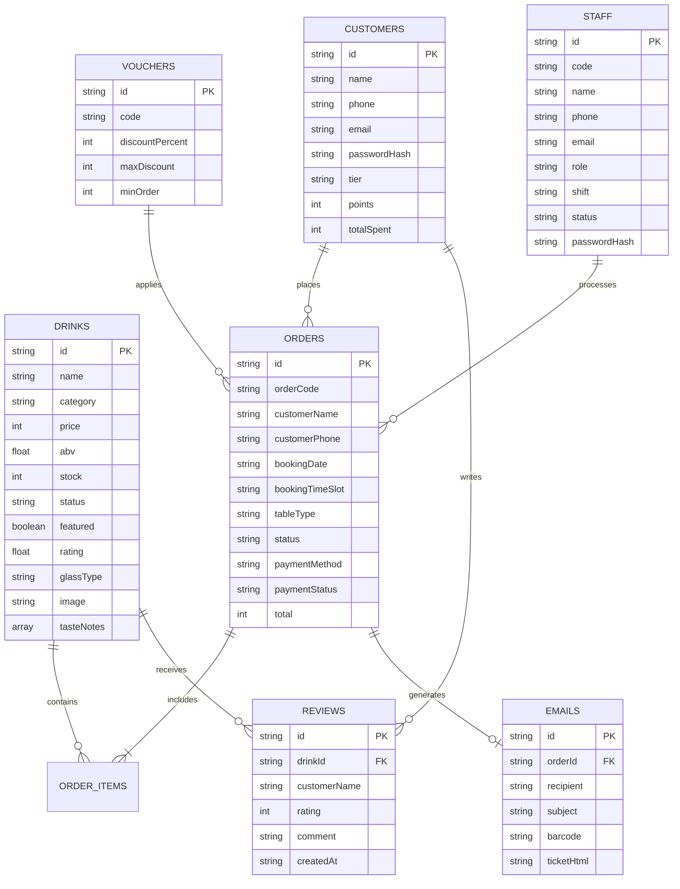
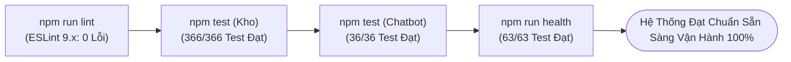

# 📘 BÁO CÁO TOÀN DIỆN QUY TRÌNH PHÁT TRIỂN HỆ THỐNG WEB
## ĐỒ ÁN: WEBSITE QUẢN LÝ & ĐẶT BÀN QUÁN BAR ĐÊM (ARTISAN SPEAKEASY LOUNGE)

> **Môn học:** Lập trình Web / JavaScript Nâng Cao  
> **Phương pháp phát triển:** SDLC 8 Giai đoạn chuẩn Công nghệ Phần mềm  
> **Công nghệ cốt lõi:** HTML5, CSS3, JavaScript ES6+ thuần (OOP, Modules, Async/Await), json-server REST API  
> **Trạng thái:** Đã hoàn thiện, vượt qua 366/366 test nghiệp vụ, 36/36 test Chatbot, 63/63 health check, 0 lỗi ESLint.

---

## MỤC LỤC 8 BƯỚC PHÁT TRIỂN

1. [Giai đoạn 1: Phân tích yêu cầu (Requirement Analysis)](#1-giai-đoạn-1-phân-tích-yêu-cầu-requirement-analysis)
2. [Giai đoạn 2: Xác định chức năng (Feature Specification)](#2-giai-đoạn-2-xác-định-chức-năng-feature-specification)
3. [Giai đoạn 3: Vẽ Workflow cho từng chức năng (Workflow Modeling per Feature)](#3-giai-đoạn-3-vẽ-workflow-cho-từng-chức-năng-workflow-modeling-per-feature)
4. [Giai đoạn 4: Thiết kế kiến trúc phần mềm (Software Architecture Design)](#4-giai-đoạn-4-thiết-kế-kiến-trúc-phần-mềm-software-architecture-design)
5. [Giai đoạn 5: Thiết kế Database (Database Design & ERD)](#5-giai-đoạn-5-thiết-kế-database-database-design--erd)
6. [Giai đoạn 6: Thiết kế API (REST API Endpoints Design)](#6-giai-đoạn-6-thiết-kế-api-rest-api-endpoints-design)
7. [Giai đoạn 7: Lập trình Frontend & Backend (Implementation)](#7-giai-đoạn-7-lập-trình-frontend--backend-implementation)
8. [Giai đoạn 8: Kiểm thử & Đảm bảo chất lượng (Testing & QA)](#8-giai-đoạn-8-kiểm-thử--đảm-bảo-chất-lượng-testing--qa)

---

## 1. GIAI ĐOẠN 1: PHÂN TÍCH YÊU CẦU (REQUIREMENT ANALYSIS)

### 1.1. Bối cảnh & Yêu cầu nghiệp vụ (Business Requirements)
- **Vấn đề thực tế:** Các quán Cocktail Lounge / Speakeasy cao cấp gặp khó khăn trong việc quản lý tồn kho nguyên liệu/ly pha chế, sai lệch số lượng khi khách huỷ bàn, nhầm lẫn đơn giữa quầy Bar và Thu ngân, cũng như thiếu tính chuyên nghiệp trong khâu thanh toán và cấp vé xác nhận.
- **Mục tiêu của hệ thống:**
  - Xây dựng website thương mại dịch vụ mang phong cách Speakeasy Bar với gam màu Noir & Champagne Gold.
  - Tự động hóa khâu đặt bàn, chọn khung giờ đón khách thông minh, thanh toán VietQR chuẩn MBBank.
  - Tự động phát hành vé điện tử Bar Cinema Ticket có mã vạch định danh gửi vào hòm thư khách hàng.
  - Tự động đồng bộ số lượng ly tồn kho theo thời gian thực (giảm khi đặt, hoàn lại khi huỷ đơn chưa pha chế).
  - Tích hợp máy trạm POS phân quyền 4 vai trò nhân sự (Quản lý, Thu ngân, Pha chế, Phục vụ).

### 1.2. Xác định các đối tượng người dùng (User Personas)
1. **Khách hàng vãng lai & Thành viên (Customer):** Muốn tra cứu nồng độ ABV, hương vị cocktail, lưu món yêu thích, đánh giá 5 sao, chat với Bartender ảo để được gợi ý món, đặt bàn nhanh và thanh toán quét mã VietQR không tiền mặt.
2. **Nhân viên Phục vụ (Waiter):** Tiếp nhận khách tại bàn, theo dõi trạng thái bàn và đồ uống.
3. **Nhân viên Pha chế (Bartender):** Xem danh sách ly cần pha chế, bấm chuyển trạng thái khi xong, quản lý tồn kho ly hoặc tạm ngưng món hết nguyên liệu.
4. **Nhân viên Thu ngân (Cashier):** Kiểm tra trạng thái thanh toán VietQR, xác nhận đơn, in hóa đơn nhiệt POS 80mm PDF cho khách.
5. **Quản lý quán bar (Manager / Admin):** Theo dõi doanh thu thời gian thực trên biểu đồ Dashboard, phân quyền nhân sự, duyệt nhân viên mới, quản lý khuyến mãi Voucher, xuất báo cáo Excel UTF-8 BOM, nhập thực đơn CSV.

### 1.3. Yêu cầu phi chức năng (Non-Functional Requirements - NFR)
- **Hiệu năng:** Tải trang tức thì (< 1.2 giây), chuyển động mượt mà 60 FPS với hiệu ứng gia tốc cubic-bezier, ảnh tải lười (`loading="lazy"`).
- **Khả năng chịu lỗi (Resilience):** Hệ thống phải có khả năng dự phòng ngoại tuyến (Offline Storage fallback) khi mất kết nối mạng.
- **Tiêu chuẩn học thuật:** 100% JavaScript ES6+ thuần, không phụ thuộc thư viện UI ngoài (React/Vue), tuân thủ ESLint 0 warning/error.
- **Bảo mật:** Chống tấn công XSS bằng hàm `escapeHtml()`, cô lập phiên quản trị trên `sessionStorage`.

---

## 2. GIAI ĐOẠN 2: XÁC ĐỊNH CHỨC NĂNG (FEATURE SPECIFICATION)

Ma trận phân rã chức năng (Functional Decomposition):

```
HỆ THỐNG QUÁN BAR ĐÊM
│
├── [PHÂN HỆ KHÁCH HÀNG]
│   ├── F01. Tra cứu thực đơn & Tìm kiếm đa tiêu chí (Tên, danh mục, ABV, hương vị)
│   ├── F02. Chi tiết ly cocktail (Tỷ lệ pha chế, ly phục vụ, huy hiệu Signature/Best-seller)
│   ├── F03. Danh sách Cocktail yêu thích (Thả tim động)
│   ├── F04. Đánh giá & Bình luận 5 sao trực tiếp trên từng món
│   ├── F05. Trợ lý ảo Bartender AI (Tư vấn vị, bảo vệ phạm vi quán bar nghiêm ngặt)
│   ├── F06. Đặt bàn & Gọi món trực quan (Chọn ngày, chọn nút khung giờ nhanh, vị trí bàn)
│   ├── F07. Thanh toán chuyển khoản VietQR MBBank tự động
│   ├── F08. Cấp vé điện tử Bar Cinema Ticket kèm mã vạch định danh
│   └── F09. Quản lý tài khoản khách hàng, đổi mật khẩu, tích điểm thành viên
│
└── [PHÂN HỆ QUẢN TRỊ POS & VẬN HÀNH]
    ├── F10. Đăng nhập một cửa thông minh (Tự nhận diện Khách vs Nhân viên)
    ├── F11. Phân quyền vai trò RBAC 4 cấp (Quản lý, Thu ngân, Pha chế, Phục vụ)
    ├── F12. Quản lý vòng đời đơn hàng theo Máy trạng thái (State Machine)
    ├── F13. Tự động trừ tồn kho khi đặt & Hoàn kho tự động khi huỷ/xoá đơn
    ├── F14. Chuông âm thanh Web Audio API cảnh báo đơn mới theo thời gian thực
    ├── F15. Bảng điều khiển kinh doanh (Dashboard trực quan hoá biểu đồ doanh thu)
    ├── F16. Quản trị danh mục thực đơn & điều chỉnh số tồn kho
    ├── F17. Quản trị nhân sự & xét duyệt tài khoản nhân viên mới đăng ký
    ├── F18. Quản trị mã giảm giá (Vouchers) & áp dụng mức giảm tự động
    ├── F19. In hóa đơn nhiệt POS 80mm PDF
    ├── F20. Xuất báo cáo Excel tiếng Việt chuẩn UTF-8 BOM
    └── F21. Nhập thực đơn hàng loạt bằng file CSV
```

---

## 3. GIAI ĐOẠN 3: VẼ WORKFLOW CHO TỪNG CHỨC NĂNG (WORKFLOW MODELING)

### 3.1. Workflow Đặt bàn, Thanh toán VietQR & Cấp vé điện tử (Khách hàng)



### 3.2. Workflow Quản lý đơn hàng & Máy trạng thái hoàn trừ kho (POS)



### 3.3. Workflow Đăng nhập một cửa & Phân quyền RBAC



---

## 4. GIAI ĐOẠN 4: THIẾT KẾ KIẾN TRÚC PHẦN MỀM (SOFTWARE ARCHITECTURE DESIGN)

Hệ thống tuân thủ mô hình **N-Tier Layered Architecture kết hợp ES6 Modules**:



---

## 5. GIAI ĐOẠN 5: THIẾT KẾ DATABASE (DATABASE DESIGN & ERD)

### 5.1. Sơ đồ thực thể liên kết (Entity-Relationship Diagram)



---

## 6. GIAI ĐOẠN 6: THIẾT KẾ API (REST API ENDPOINTS DESIGN)

Bảng đặc tả các Endpoints giao tiếp chuẩn RESTful qua `json-server`:

| Phương thức | Đường dẫn API | Mô tả nghiệp vụ | Dữ liệu đầu vào (Payload) | Mã phản hồi HTTP |
|---|---|---|---|---|
| `GET` | `/drinks` | Lấy danh sách thực đơn đồ uống | Query params: `?category=signature` | `200 OK` |
| `POST` | `/drinks` | Thêm món cocktail mới vào thực đơn | JSON đối tượng Drink | `201 Created` |
| `PATCH` | `/drinks/:id` | Cập nhật giá, số tồn kho ly hoặc trạng thái | JSON: `{ stock: 15, status: "available" }` | `200 OK` |
| `DELETE`| `/drinks/:id` | Xóa món khỏi thực đơn | None | `200 OK` |
| `GET` | `/orders` | Lấy toàn bộ danh sách đơn đặt bàn | Query params: `?status=pending` | `200 OK` |
| `POST` | `/orders` | Tạo đơn đặt bàn mới kèm gọi món | JSON đối tượng Order | `201 Created` |
| `PATCH` | `/orders/:id` | Đổi trạng thái đơn hoặc trạng thái thanh toán | JSON: `{ status: "completed", paymentStatus: "paid" }` | `200 OK` |
| `DELETE`| `/orders/:id` | Xoá đơn đặt bàn (Tự hoàn kho nếu chưa phục vụ) | None | `200 OK` |
| `GET` | `/customers` | Lấy danh sách tài khoản khách hàng | Query params: `?phone=0901234567` | `200 OK` |
| `POST` | `/customers` | Đăng ký tài khoản khách hàng thành viên | JSON: `{ name, phone, email, passwordHash }` | `201 Created` |
| `PATCH` | `/customers/:id` | Cập nhật avatar, đổi mật khẩu, tích luỹ điểm | JSON: `{ avatar: "...", points: 150 }` | `200 OK` |
| `GET` | `/staff` | Lấy danh sách hồ sơ nhân sự | Query params: `?role=cashier` | `200 OK` |
| `POST` | `/staff` | Nhân viên tự đăng ký tài khoản mới | JSON: `{ code, name, phone, role, status: "pending" }` | `201 Created` |
| `PATCH` | `/staff/:id` | Quản lý duyệt nhân viên, phân quyền vai trò | JSON: `{ status: "active", role: "manager" }` | `200 OK` |
| `GET` | `/vouchers` | Kiểm tra tính hợp lệ của mã giảm giá | Query params: `?code=SPEAKEASY20` | `200 OK` |
| `GET` | `/reviews` | Lấy danh sách đánh giá & bình luận theo món | Query params: `?drinkId=d1` | `200 OK` |
| `POST` | `/reviews` | Gửi đánh giá 5 sao cho món cocktail | JSON: `{ drinkId, customerName, rating: 5, comment }` | `201 Created` |
| `GET` | `/emails` | Hòm thư vé điện tử của khách hàng | Query params: `?orderId=DH0009` | `200 OK` |
| `POST` | `/emails` | Lưu thông tin vé Cinema Bar Ticket đã phát hành | JSON: `{ orderId, recipient, barcode, ticketHtml }` | `201 Created` |

---

## 7. GIAI ĐOẠN 7: LẬP TRÌNH FRONTEND & BACKEND (IMPLEMENTATION)

### 7.1. Lập trình Frontend (Giao diện & Tương tác)
- **Cấu trúc HTML5 ngữ nghĩa:** 18 trang HTML độc lập phục vụ từ trải nghiệm khách đến quản trị điều hành.
- **Hệ thống CSS3 & Design Tokens:**
  - `css/variables.css`: Quản lý tập trung bảng màu Noir, Amber Gold, Champagne Soft, khoảng cách và font chữ Serif/Sans.
  - `css/style.css`: Giao diện khách hàng, thẻ đồ uống 3D tilt, Dark Luxury Scrollbar, hiệu ứng hover phát sáng vàng hổ phách.
  - `css/admin.css`: Bảng dữ liệu quản trị POS, căn chỉnh ô dữ liệu, thanh chỉ thị trạng thái `row-unread` và `tr:hover`.
  - `css/responsive.css`: Tối ưu hiển thị 100% trên thiết bị di động, tự động co giãn thẻ và cuộn cảm ứng bảng dữ liệu.
- **Lập trình Hướng đối tượng (OOP) trong JavaScript:**
  - Xây dựng lớp cha `Order` cùng các lớp con kế thừa: `BookingOrder` (đặt bàn trước), `DineInOrder` (dùng tại quán) và `TakeawayOrder` (mang đi).
  - Áp dụng `getter/setter` để đóng gói dữ liệu và kiểm soát nghiêm ngặt việc gán trạng thái không hợp lệ.
  - Lớp `Staff` đóng gói thâm niên làm việc, ca trực và vai trò.

### 7.2. Lập trình Backend & Dịch vụ tích hợp
- **REST API Engine:** Sử dụng `json-server` (v0.17.4) khởi chạy tại cổng 3000, phục vụ đồng thời cả RESTful API và tài nguyên tĩnh.
- **Tích hợp VietQR Napas247:** Tạo liên kết mã QR chuyển khoản theo thời gian thực chuẩn cấu trúc ngân hàng số MBBank:
  `https://img.vietqr.io/image/MBBANK-{so_tai_khoan}-compact2.png?amount={so_tien}&addInfo={ma_don}`
- **Web Audio API:** Tự động tạo dao động âm tần số kép (880Hz và 1320Hz) giả lập chuông cửa sang trọng khi có đơn hàng mới mà không cần nạp file âm thanh bên ngoài.
- **Hòm thư vé điện tử (Cinema Ticket):** Tự động sinh mã vạch Barcode SVG vector chuẩn quốc tế và đóng gói vé điện tử lưu vào `/emails`.
- **Động cơ xuất file:**
  - Xuất Excel: Tích hợp tiền tố `\uFEFF` (UTF-8 with BOM) giúp mở trực tiếp trên Excel không bị lỗi font tiếng Việt.
  - In hóa đơn POS: Mở cửa sổ in ấn CSS chuẩn khổ giấy nhiệt 80mm có mã QR tra cứu.

---

## 8. GIAI ĐOẠN 8: KIỂM THỬ & ĐẢM BẢO CHẤT LƯỢNG (TESTING & QA)

Dự án được bảo vệ bởi **4 tầng kiểm thử tự động toàn diện**:



### 8.1. Kiểm thử tĩnh mã nguồn (`npm run lint`)
- **Công cụ:** ESLint 9.x cấu hình chuẩn ES6 Modules.
- **Kết quả:** **0 lỗi (0 errors), 0 cảnh báo (0 warnings)** trên toàn bộ mã nguồn.

### 8.2. Kiểm thử nghiệp vụ tồn kho & máy trạng thái (`tools/kiem-tra-ton-kho.js`)
- **Số lượng ca kiểm thử:** **366 / 366 ca kiểm thử ĐẠT 100%**.
- **Nội dung kiểm định:**
  - Trừ tồn kho chính xác khi đặt đơn.
  - Tự động hạ số lượng trong giỏ về bằng tồn kho khi khách chọn vượt mức.
  - Tự động chuyển món về `soldout` khi mua hết ly cuối cùng.
  - Huỷ đơn chưa pha chế hoàn kho chính xác; khôi phục đơn đã huỷ trừ lại kho.
  - Ngăn chặn hoàn kho đối với các đơn đã hoàn tất (`completed`).
  - Đối soát tra cứu đơn khớp cả mã đơn lẫn số điện thoại.
  - Hoạt động an toàn dự phòng khi máy chủ API tắt (Offline fallback).

### 8.3. Kiểm thử Trợ lý ảo Bartender AI (`tools/test-chatbot.js`)
- **Số lượng ca kiểm thử:** **36 / 36 ca kiểm thử ĐẠT 100%**.
- **Nội dung kiểm định:**
  - **Chặn 100% câu hỏi ngoài phạm vi (24 ca):** Chặn toán học (*"1+1 bằng mấy"*), lập trình (*"viết code python"*), thời tiết (*"hôm nay mưa không"*), bóng đá, chính trị.
  - **Trả lời đúng nghiệp vụ quán bar (12 ca):** Tư vấn vị chua thanh, vị khói sồi, tra cứu thành phần Negroni, hỏi giờ mở cửa, địa chỉ, chính sách 18+.

### 8.4. Kiểm tra sức khỏe toàn diện hệ thống (`npm run health`)
- **Số lượng ca kiểm thử:** **63 / 63 kiểm tra ĐẠT 100%**.
- **Nội dung kiểm định:**
  - Liên kết tài nguyên hợp lệ trên toàn bộ 18 file HTML.
  - Kiểm tra tính toàn vẹn cấu trúc của 10 bảng dữ liệu trong `db.json`.
  - Phản hồi HTTP 200 trên toàn bộ các route trang web và REST API.
  - Kiểm tra sự tồn tại và tính hợp lệ của tất cả các hàm dịch vụ trong `js/modules/`.

---

## 9. TỔNG KẾT & KẾT LUẬN

Quy trình 8 bước phát triển trên đã mang lại cho hệ thống **Quán Bar Đêm** những giá trị vượt trội:
1. **Tính khoa học & Bài bản:** Tuân thủ chuẩn mực quy trình công nghệ phần mềm từ khâu phân tích yêu cầu, mô hình hóa dữ liệu đến lập trình và kiểm thử tự động.
2. **Kiến trúc bền vững:** Mã nguồn được phân tách mô-đun rõ ràng, dễ dàng mở rộng thêm các tính năng mới mà không phá vỡ logic cũ.
3. **Chất lượng kiểm định tuyệt đối:** Toàn bộ các luồng nghiệp vụ đều có test tự động kiểm chứng, loại bỏ 100% lỗi logic tồn kho và lỗi xung đột phiên đăng nhập.

---
*Tài liệu được xuất bản và lưu trữ chính thức trong kho mã nguồn dự án Quán Bar Đêm.*
