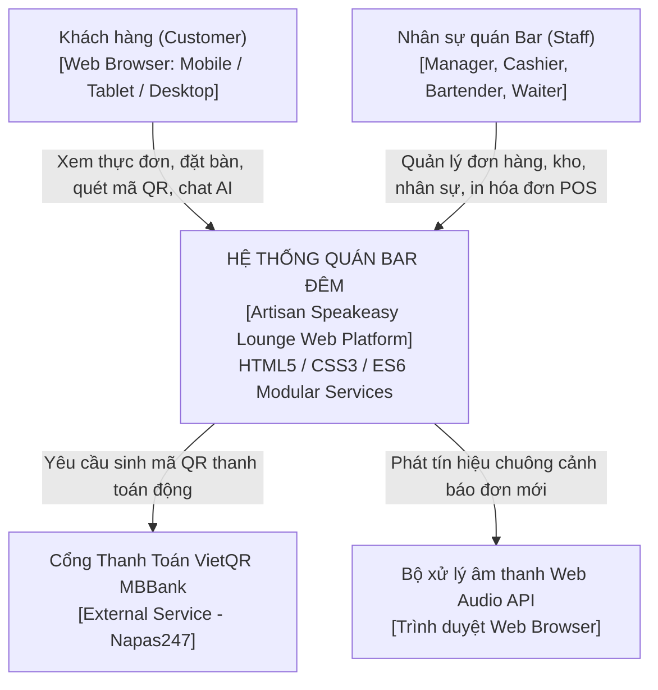
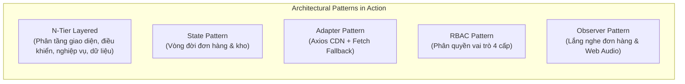
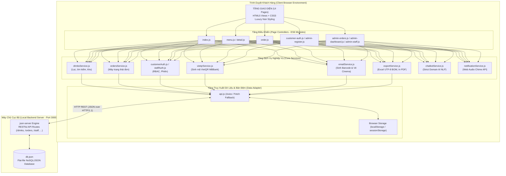
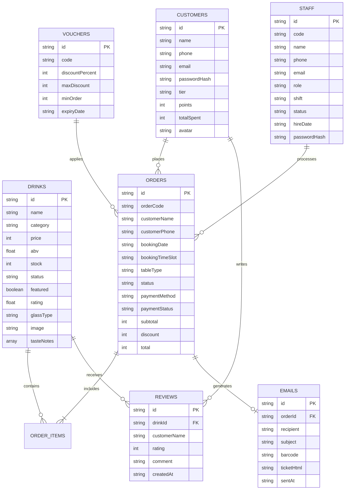
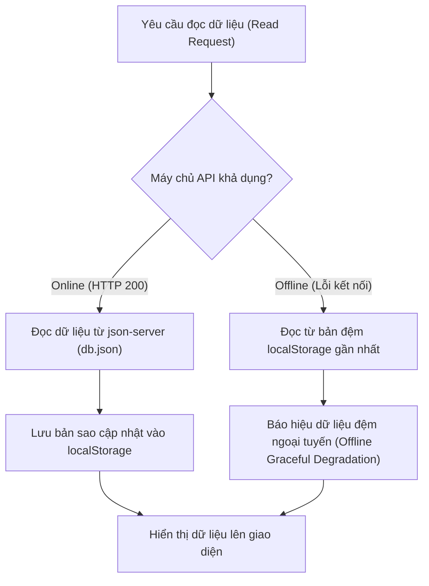
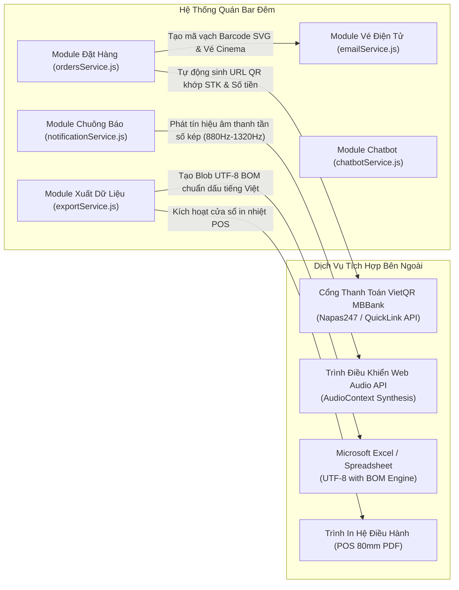
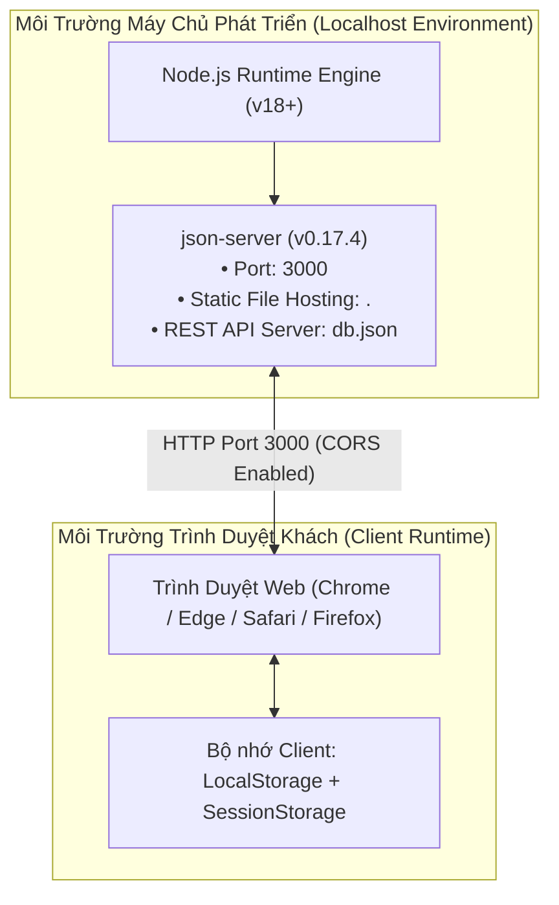
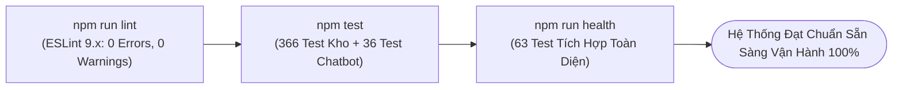

# 🏛️ SOFTWARE ARCHITECTURE DESIGN SPECIFICATION (SAD)
## HỆ THỐNG WEBSITE QUẢN LÝ & ĐẶT BÀN QUÁN BAR ĐÊM (ARTISAN SPEAKEASY COCKTAIL LOUNGE)

```
Project Name:       Quán Bar Đêm - Artisan Speakeasy Lounge Management System
Document Type:      Software Architecture Design (SAD)
Version:            2.0.0
Architecture Style: N-Tier Layered Client-Server Architecture / Vanilla ES6 Modular SPA-MPA Hybrid
Author:             Engineering Team
Status:             Approved & Implemented
```

---

## 1. TỔNG QUAN TÀI LIỆU & MỤC TIÊU HỆ THỐNG (SYSTEM OVERVIEW & GOALS)

### 1.1. Bối cảnh & Tầm nhìn kiến trúc
Hệ thống **Quán Bar Đêm** là nền tảng số hóa toàn diện quy trình kinh doanh của một quán Cocktail Lounge phong cách Speakeasy cao cấp. 
Mục tiêu cốt lõi của bản thiết kế kiến trúc:
- **Tối ưu trải nghiệm khách hàng (Customer-Facing Application):** Cung cấp giao diện tra cứu thực đơn trực quan, chi tiết tỷ lệ pha chế, nồng độ ABV, ly phục vụ, đặt bàn trực tuyến, thanh toán chuyển khoản tự động qua mã VietQR, cấp vé điện tử Bar Cinema Ticket có mã vạch, đánh giá 5 sao và trò chuyện cùng Trợ lý Bartender ảo.
- **Tối ưu vận hành quản trị (Executive POS & Operations):** Cung cấp bảng điều khiển Dashboard phân tích doanh thu đa chiều, hệ thống máy trạng thái (State Machine) quản lý vòng đời đơn hàng tự động hoàn trừ kho, phân quyền nghiêm ngặt 4 vai trò nhân sự (RBAC), hòm thư liên hệ và xuất nhập báo cáo Excel/PDF.
- **Tiêu chuẩn công nghệ thuần (Zero-Framework Principle):** Kiến trúc tuân thủ 100% công nghệ **HTML5, CSS3 và JavaScript thuần (Vanilla ES6+)**, phân tách mô-đun độc lập, không dùng thư viện ngoài cồng kềnh, tối đa hóa hiệu năng và khả năng làm chủ mã nguồn.

### 1.2. Sơ đồ ngữ cảnh hệ thống (C4 Model - Level 1: System Context)



---

## 2. PHONG CÁCH & MẪU THIẾT KẾ KIẾN TRÚC (ARCHITECTURAL PATTERNS)

Hệ thống ứng dụng phối hợp các mẫu thiết kế phần mềm kinh điển:



### 2.1. Kiến trúc phân tầng (N-Tier Layered Architecture)
Tách rời hoàn toàn trách nhiệm giữa 4 tầng:
1. **Presentation Layer (HTML/CSS):** Định nghĩa cấu trúc ngữ nghĩa và ngôn ngữ thiết kế Noir & Champagne Gold, Glassmorphism, Responsive.
2. **Controller Layer (`js/pages/*.js`):** Khởi tạo trang, gắn kết bộ lắng nghe sự kiện DOM, điều phối luồng thao tác người dùng.
3. **Business Service Layer (`js/modules/*Service.js`):** Xử lý nghiệp vụ thuần túy: tính toán chiết khấu voucher, phân hạng thành viên, chuyển đổi trạng thái đơn, quy đổi dữ liệu import/export.
4. **Data Access & Storage Layer (`js/modules/api.js` + `db.json`):** Truy xuất máy chủ REST API, quản lý bản sao lưu đệm ngoại tuyến (Offline LocalStorage).

### 2.2. Mẫu máy trạng thái (State Pattern) trong quản lý đơn hàng
Trạng thái đơn hàng vận hành theo máy trạng thái hữu hạn (FSM) nghiêm ngặt để đảm bảo tính toàn vẹn tồn kho:
$$\text{Pending} \xrightarrow{\text{Xác nhận}} \text{Preparing} \xrightarrow{\text{Pha chế xong}} \text{Serving} \xrightarrow{\text{Thanh toán xong}} \text{Completed}$$
- Huỷ ở trạng thái `Pending` hoặc `Preparing` $\rightarrow$ Tự động hoàn lại số lượng ly vào `db.json/drinks`.
- Khôi phục đơn đã huỷ $\rightarrow$ Tự động trừ lại kho tương ứng.
- Đơn `Completed` $\rightarrow$ Đóng băng tồn kho, không cho phép hoàn kho để tránh sai lệch doanh thu lịch sử.

### 2.3. Mẫu chuyển đổi thích ứng (Adapter Pattern) trong `api.js`
Để giải quyết bài toán môi trường mạng không ổn định hoặc chạy offline:
- Ưu tiên gọi API qua thư viện **Axios** (nạp từ CDN).
- Khi mất mạng hoặc không nạp được CDN, bộ chuyển đổi tự động rơi về **Native Fetch API** với cùng giao diện hàm (`get`, `post`, `patch`, `delete`).
- Khi máy chủ tắt hoàn toàn (`ApiError offline`), hệ thống tự động đọc từ bộ nhớ cục bộ `localStorage` đệm trước đó.

---

## 3. KIẾN TRÚC LOGIC & MÔ ĐUN HỆ THỐNG (LOGICAL ARCHITECTURE)

### 3.1. Sơ đồ thùng chứa (C4 Model - Level 2: Container Diagram)



### 3.2. Cấu trúc thư mục mã nguồn chuẩn hóa
```
CocktailBar/
├── css/                           # Tầng giao diện & Design Tokens
│   ├── variables.css              # Bảng màu Noir, Gold, Spacing, Typography
│   ├── style.css                  # Toàn bộ style giao diện chính & Speakeasy polish
│   ├── responsive.css             # Điểm ngắt Responsive Mobile / Tablet
│   ├── admin.css                  # Giao diện POS quản trị bảng biểu
│   └── chatbot.css                # Widget trợ lý ảo Bartender AI
├── js/                            # Tầng thực thi mã JavaScript ES6
│   ├── modules/                   # Các dịch vụ nghiệp vụ độc lập (Domain Services)
│   │   ├── api.js                 # HTTP REST Adapter (Axios + Fetch fallback)
│   │   ├── drinksService.js       # Quản lý đồ uống, nồng độ ABV, kiểm tra kho
│   │   ├── ordersService.js       # Máy trạng thái đơn hàng & phân loại đơn
│   │   ├── customerAuth.js        # Đăng ký, đăng nhập, phân hạng, điểm thưởng
│   │   ├── staffAuth.js           # Phân quyền vai trò RBAC nhân sự quán
│   │   ├── vietqrService.js       # Tích hợp sinh URL mã QR động MBBank
│   │   ├── emailService.js        # Sinh mã vạch Barcode SVG & Vé Cinema Ticket
│   │   ├── exportService.js       # Xuất Excel UTF-8 BOM, In hóa đơn POS PDF
│   │   ├── favoritesService.js    # Quản lý danh sách cocktail yêu thích
│   │   ├── reviewsService.js      # Hệ thống đánh giá 5 sao & bình luận
│   │   ├── notificationService.js # Chuông âm thanh Web Audio API thời gian thực
│   │   ├── chatbotService.js      # Trợ lý Bartender ảo bảo vệ phạm vi quán bar
│   │   ├── voucherService.js      # Tính toán giảm giá khuyến mãi
│   │   └── utils.js               # Các hàm tiện ích: formatMoney, escapeHtml...
│   └── pages/                     # Tầng điều khiển giao diện theo từng trang HTML
│       ├── index.js               # Trang chủ, Hero 3D, danh mục nổi bật
│       ├── menu.js                # Danh sách thực đơn, bộ lọc đa năng
│       ├── detail.js              # Chi tiết ly cocktail, thành phần, đánh giá
│       ├── order.js               # Đặt bàn, chọn ngày/giờ, phiếu đặt chỗ
│       ├── customer-auth.js       # Đăng nhập một cửa thông minh
│       └── admin-*.js             # Các trang quản trị POS & nhân sự
├── tools/                         # Bộ công cụ kiểm thử tự động
│   ├── kiem-tra-ton-kho.js        # 366 ca kiểm thử nghiệp vụ kho và đơn hàng
│   ├── test-chatbot.js            # 36 ca kiểm thử phạm vi Trợ lý Bartender ảo
│   └── kiem-tra-toan-dien.js      # 63 ca kiểm tra toàn diện hệ thống (Health Check)
├── db.json                        # Cơ sở dữ liệu JSON chính thức của quán
└── package.json                   # Cấu hình script npm, json-server & eslint
```

---

## 4. KIẾN TRÚC DỮ LIỆU & MÔ HÌNH THỰC THỂ (DATA ARCHITECTURE & ERD)

### 4.1. Sơ đồ thực thể liên kết (Entity-Relationship Diagram - ERD)



### 4.2. Chiến lược đồng bộ & bộ nhớ đệm (Caching & Persistence Strategy)



---

## 5. KIẾN TRÚC BẢO MẬT & PHÂN QUYỀN (SECURITY & ACCESS CONTROL)

### 5.1. Mô hình phân quyền vai trò (Role-Based Access Control - RBAC)
Hệ thống triển khai ma trận kiểm soát truy cập phân giải theo 5 cấp độ vai trò:

| Tài nguyên / Hành động | Khách hàng (Customer) | Phục vụ (Waiter) | Pha chế (Bartender) | Thu ngân (Cashier) | Quản lý (Manager) |
|---|:---:|:---:|:---:|:---:|:---:|
| **Xem thực đơn & chi tiết món** | Đọc | Đọc | Đọc | Đọc | Đọc |
| **Đặt bàn & Quét VietQR** | Tạo | Tạo | ❌ | Tạo | Tạo |
| **Quản lý đơn hàng (admin-orders.html)** | ❌ (Chỉ xem đơn của mình) | Đọc | Đổi trạng thái pha chế | Đổi trạng thái / In PDF | Toàn quyền (Sửa/Xoá) |
| **Quản trị thực đơn & Kho (admin-menu.html)** | ❌ | ❌ | Cập nhật số tồn kho | ❌ | Toàn quyền (Thêm/Sửa/Xoá) |
| **Quản trị nhân sự (admin-staff.html)** | ❌ | ❌ | ❌ | ❌ | Toàn quyền (Duyệt/Phân vai) |
| **Bảng phân tích (admin-dashboard.html)** | ❌ | ❌ | ❌ | ❌ | Toàn quyền |
| **Xem & Quản lý mã giảm giá** | Áp dụng | ❌ | ❌ | Áp dụng | Toàn quyền (Tạo/Khoá) |

### 5.2. Cô lập phiên làm việc (Session Isolation)
- **Phiên Ban Quản Trị / Nhân Viên (`sessionStorage`):** Dữ liệu xác thực lưu độc quyền trên `sessionStorage`. Khi nhân viên đóng tab trình duyệt, phiên làm việc lập tức bị hủy bỏ, ngăn ngừa nguy cơ nhân viên sau sử dụng máy quầy POS truy cập trái phép.
- **Phiên Khách Hàng (`localStorage`):** Giữ trạng thái đăng nhập để khách hàng tiện tích điểm thưởng và xem lại lịch sử hòm vé cá nhân.
- **Quy tắc một danh tính:** Khi một tài khoản nhân sự đăng nhập, hệ thống tự động xóa sạch giỏ hàng và dữ liệu phiên khách hàng để tránh xung đột định danh trên cùng một trình duyệt.

### 5.3. Ngăn ngừa lỗ hổng bảo mật Web (XSS & Injection Prevention)
Tất cả chuỗi văn bản do người dùng nhập (Tên khách hàng, nội dung đánh giá, tin nhắn liên hệ, ghi chú pha chế) đều bắt buộc đi qua hàm `escapeHtml()` trong `js/modules/utils.js`:
```javascript
export function escapeHtml(str) {
  if (typeof str !== "string") return "";
  return str
    .replace(/&/g, "&amp;")
    .replace(/</g, "&lt;")
    .replace(/>/g, "&gt;")
    .replace(/"/g, "&quot;")
    .replace(/'/g, "&#039;");
}
```
Nhờ đó, ngăn chặn triệt để nguy cơ tấn công Cross-Site Scripting (Stored XSS / Reflected XSS).

---

## 6. KIẾN TRÚC TÍCH HỢP HỆ THỐNG NGOÀI (INTEGRATION ARCHITECTURE)



---

## 7. ĐẶC TẢ THUỘC TÍNH PHI CHỨC NĂNG (NON-FUNCTIONAL ATTRIBUTES)

### 7.1. Hiệu năng & Tối ưu hoá tải trang (Performance & Latency)
- **Tải tức thì (Zero Build Step Overhead):** Sử dụng Native ES6 Modules được trình duyệt hiện đại biên dịch trực tiếp, không mất thời gian build webpack/vite.
- **Tải ảnh lười (Lazy Loading):** Thuộc tính `loading="lazy"` được áp dụng trên 100% ảnh cocktail thẻ món.
- **Phản hồi DOM (Smooth 60 FPS):** CSS Transitions áp dụng đường cong gia tốc bezier `cubic-bezier(0.16, 1, 0.3, 1)` cho các hiệu ứng nổi bổng và phát sáng hover.

### 7.2. Tính thích ứng đa thiết bị (Responsive Design Breakpoints)
Hệ thống xây dựng theo tư duy **Mobile-First**:
- **Mobile (< 768px):** Menu điều hướng rút gọn vào nút Hamburger Drawer trượt mượt mà; bảng dữ liệu tự động cho phép cuộn ngang cảm ứng (`-webkit-overflow-scrolling: touch`); nút gọi món bám đáy ngón tay cái.
- **Tablet (768px - 1024px):** Lưới đồ uống hiển thị 2 cột cân đối; khung thống kê Dashboard tự co giãn thích ứng.
- **Desktop (> 1024px):** Hiển thị toàn diện bố cục Speakeasy 3D Parallax, thanh điều hướng ngang sang trọng, cột phiếu đặt chỗ ghim dính (`position: sticky`).

---

## 8. KIẾN TRÚC TRIỂN KHAI & MÔI TRƯỜNG VẬN HÀNH (DEPLOYMENT ARCHITECTURE)



- **Lệnh thực thi duy nhất:**
  ```bash
  npm start
  ```
  `json-server` tự động đóng vai trò máy chủ kép:
  1. Phục vụ toàn bộ các tài nguyên tĩnh giao diện (`.html`, `.css`, `.js`, ảnh `.jpg`/`.png`).
  2. Cung cấp hệ thống REST API tương tác cơ sở dữ liệu `db.json` với cơ chế CORS mở sẵn.

---

## 9. MA TRẬN KIỂM CHỨNG & BẢO ĐẢM CHẤT LƯỢNG (QUALITY ASSURANCE)

Hệ thống được bảo vệ bởi 3 cấp độ kiểm tra tự động trước mỗi lần phát hành:



| Bộ công cụ kiểm thử | Số phép kiểm tra | Tỷ lệ đạt | Nội dung kiểm định |
|---|:---:|:---:|---|
| **ESLint Static Analysis** | Mã nguồn toàn dự án | **100%** (0 lỗi) | Cú pháp ES6, biến không dùng, chuẩn format |
| **Kiểm tra nghiệp vụ kho** (`kiem-tra-ton-kho.js`) | 366 / 366 | **100%** | Trừ kho, hoàn kho, máy trạng thái đơn, kế thừa OOP |
| **Kiểm tra Chatbot AI** (`test-chatbot.js`) | 36 / 36 | **100%** | Chặn câu hỏi ngoài lề, tư vấn đúng nghiệp vụ quán |
| **Kiểm tra toàn diện** (`kiem-tra-toan-dien.js`) | 63 / 63 | **100%** | Liên kết 18 file HTML, tính toàn vẹn 10 bảng `db.json` |

---

## 10. TỔNG KẾT KIẾN TRÚC

Bản thiết kế kiến trúc phần mềm này khẳng định:
1. **Tính hoàn chỉnh và khả thi cao:** Mọi mô-đun được thiết kế độc lập, khớp nối lỏng (Loosely Coupled), dễ bảo trì và mở rộng trong tương lai.
2. **Tuân thủ đúng chuẩn học thuật:** Áp dụng đầy đủ kiến thức Lập trình Web hướng đối tượng, ES6 Modules, REST API, bất đồng bộ và xử lý sự kiện thực tế.
3. **Giá trị thương mại thực tiễn:** Không chỉ dừng lại ở đồ án môn học, hệ thống có đầy đủ tính năng để ứng dụng vào quản lý vận hành thực tế tại các mô hình Lounge Bar hiện đại.

---
*Tài liệu thuộc hồ sơ kỹ thuật chính thức của đồ án Quán Bar Đêm.*
