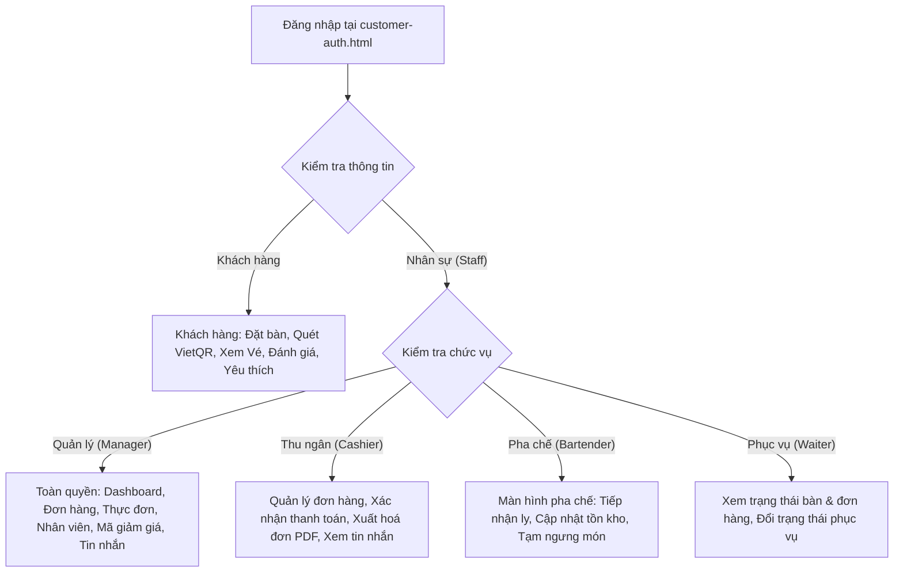
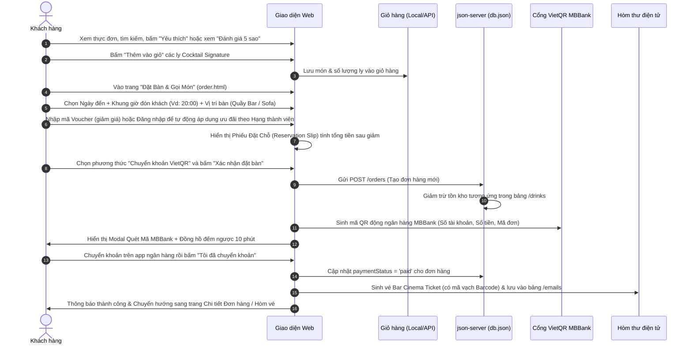
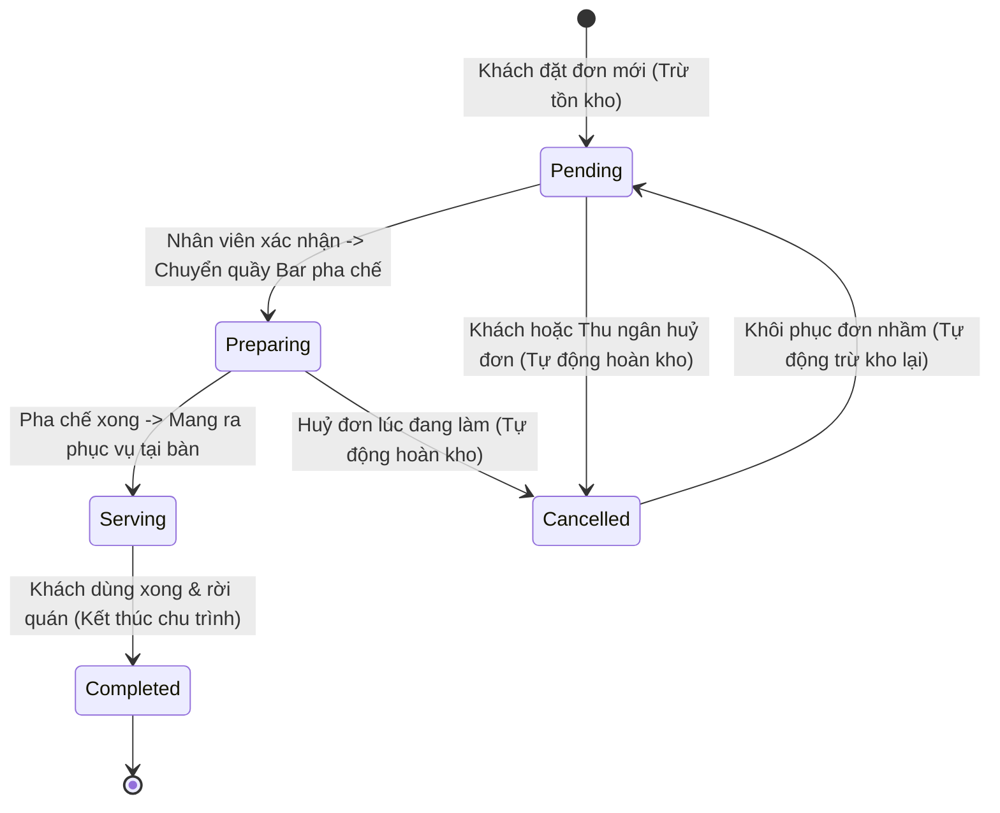
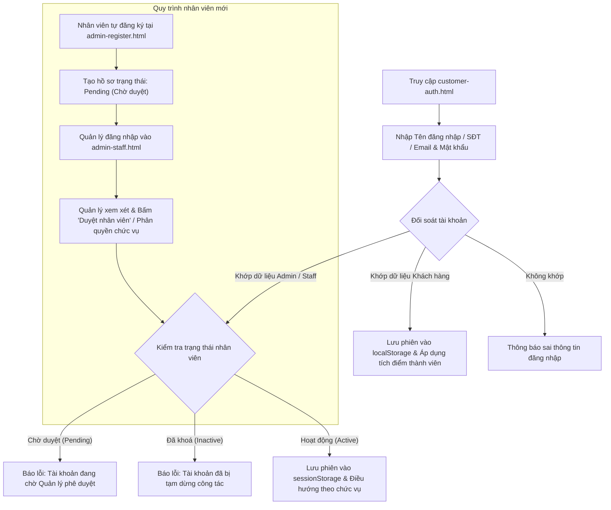
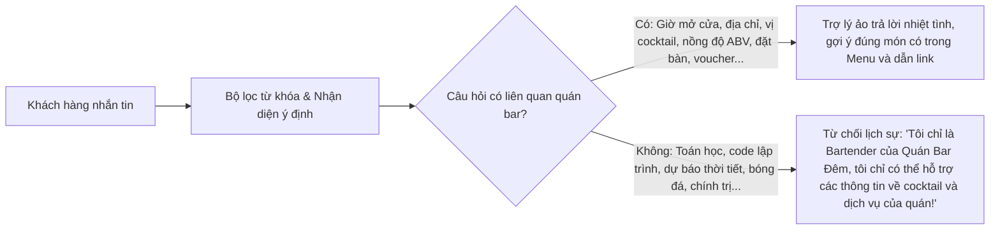

# 🍸 TỔNG QUAN ĐỒ ÁN & QUY TRÌNH HOẠT ĐỘNG (SAMPLE WORKFLOW)
## HỆ THỐNG WEBSITE QUẢN LÝ & ĐẶT BÀN QUÁN BAR ĐÊM (ARTISAN SPEAKEASY LOUNGE)

> **Môn học:** Lập trình Web / JavaScript Nâng Cao  
> **Nhóm đề tài:** Nhóm 3 — Website Quản Lý & Thương Mại Dịch Vụ  
> **Phiên bản hệ thống:** v2.0 (Kiến trúc ES6 Modules, REST API, RBAC, VietQR, Audio Alert, Chatbot AI)

---

## 1. GIỚI THIỆU TỔNG QUAN ĐỀ TÀI

### 1.1. Bối cảnh & Ý tưởng
**Quán Bar Đêm** là hệ thống web ứng dụng mô phỏng mô hình kinh doanh quán Cocktail Bar cao cấp mang phong cách **Speakeasy Lounge** (không gian sang trọng, ánh sáng vàng hổ phách, nhạc Jazz hoài cổ). Hệ thống giải quyết trọn vẹn 2 bài toán lớn trong vận hành thực tế:
1. **Dành cho khách hàng (Customer Front-end):** Trải nghiệm không gian thực đơn điện tử chuẩn quốc tế (chi tiết tỷ lệ pha chế, ABV, Tasting Notes, ly phục vụ), đặt bàn & chọn món trực quan, tích hợp thanh toán tự động qua mã VietQR chuẩn ngân hàng MBBank, nhận vé điện tử Bar Cinema Ticket qua email, đánh giá 5 sao, lưu món yêu thích và tương tác với Trợ lý ảo Bartender AI.
2. **Dành cho ban quản trị & nhân viên (Admin POS & Back-office):** Bảng điều khiển kinh doanh thông minh (Dashboard thống kê doanh thu, số ly bán, đơn theo khung giờ), máy trạng thái quản lý đơn hàng theo thời gian thực (State Machine liên kết tự động hoàn trừ tồn kho), phân quyền 4 vai trò nhân sự (Quản lý, Thu ngân, Pha chế, Phục vụ), nhập xuất file báo cáo (Excel UTF-8 BOM, In hóa đơn PDF, Import thực đơn CSV) và chuông âm thanh Web Audio cảnh báo đơn mới.

### 1.2. Mục tiêu kỹ thuật
- **100% Vanilla JavaScript (ES6+):** Sử dụng các chuẩn hiện đại như `import/export` module, Lập trình hướng đối tượng (`class`, `getter/setter`, kế thừa `extends`, đa hình), bất đồng bộ `async/await`. Không phụ thuộc vào bất kỳ framework giao diện cồng kềnh nào (React, Vue, Angular).
- **Mô hình Client - REST API thực thụ:** Tách biệt hoàn toàn tầng giao diện (HTML/CSS) và tầng máy chủ dữ liệu (`json-server` phục vụ file `db.json`).
- **Khả năng dự phòng Offline:** Tích hợp bộ đệm `localStorage` thông minh, hệ thống vẫn duy trì đọc dữ liệu mượt mà kể cả khi máy chủ API mất kết nối tạm thời.
- **Tiêu chuẩn kiểm thử & Code Quality:** Đạt **100% (366/366) test nghiệp vụ**, **36/36 test Chatbot**, **63/63 Health Check** và **0 lỗi ESLint**.

---

## 2. KIẾN TRÚC KỸ THUẬT & CÔNG NGHỆ

### 2.1. Ngăn xếp công nghệ (Tech Stack)

```
┌────────────────────────────────────────────────────────────────────────┐
│                          TẦNG GIAO DIỆN (UI/UX)                        │
│   • HTML5 ngữ nghĩa (Semantic HTML5)                                   │
│   • CSS3 Cao cấp: Noir & Champagne Gold, Glassmorphism, 3D Tilt Cards  │
│   • Dark Luxury Scrollbar, Responsive 100% Mobile / Tablet / Desktop   │
└───────────────────────────────────┬────────────────────────────────────┘
                                    │
┌───────────────────────────────────▼────────────────────────────────────┐
│                       TẦNG ĐIỀU KHIỂN & BẬT SỰ KIỆN                    │
│   • js/pages/*.js: index, menu, detail, order, auth, admin-*           │
│   • Quản lý DOM, Render dữ liệu mẫu, lắng nghe sự kiện người dùng      │
└───────────────────────────────────┬────────────────────────────────────┘
                                    │
┌───────────────────────────────────▼────────────────────────────────────┐
│                       TẦNG NGHIỆP VỤ (SERVICE LAYER)                   │
│   • drinksService: Lọc, phân loại, kiểm tra tồn kho                    │
│   • ordersService: Máy trạng thái đơn, tính toán doanh thu             │
│   • vietqrService & emailService: Mã QR MBBank, vé xem Bar Cinema      │
│   • customerAuth & staffAuth: Phân quyền vai trò RBAC, phiên làm việc  │
│   • favoritesService, reviewsService, exportService, chatbotService    │
└───────────────────────────────────┬────────────────────────────────────┘
                                    │
┌───────────────────────────────────▼────────────────────────────────────┐
│                    TẦNG TRUY XUẤT DỮ LIỆU (DATA ADAPTER)               │
│   • js/modules/api.js (Axios CDN + Fetch fallback tự động)             │
│   • Bộ đệm LocalStorage / SessionStorage dự phòng ngoại tuyến          │
└───────────────────────────────────┬────────────────────────────────────┘
                                    │
┌───────────────────────────────────▼────────────────────────────────────┐
│                      MÁY CHỦ REST API & DỮ LIỆU CỐT LÕI                │
│   • json-server (Port 3000)                                            │
│   • Cơ sở dữ liệu JSON đa thực thể: db.json                            │
└────────────────────────────────────────────────────────────────────────┘
```

### 2.2. Cơ sở dữ liệu (Database Schema trong `db.json`)

| Bảng API | Mô tả nghiệp vụ | Các trường chính |
|---|---|---|
| `/drinks` | Danh mục đồ uống, cocktail, mocktail | `id`, `name`, `category`, `price`, `abv`, `stock`, `featured`, `rating`, `image`, `tasteNotes`, `recipe` |
| `/orders` | Đơn đặt bàn & gọi món | `id`, `orderCode`, `customerName`, `customerPhone`, `bookingDate`, `bookingTimeSlot`, `tableType`, `items`, `total`, `status`, `paymentMethod`, `paymentStatus` |
| `/staff` | Hồ sơ nhân sự quán bar | `id`, `code`, `name`, `phone`, `email`, `role` (manager, cashier, bartender, waiter), `shift`, `status`, `hireDate`, `passwordHash` |
| `/customers` | Tài khoản khách hàng thành viên | `id`, `name`, `phone`, `email`, `passwordHash`, `tier` (Bronze, Silver, Gold, Platinum), `points`, `totalSpent`, `avatar` |
| `/vouchers` | Mã giảm giá ưu đãi | `code`, `discountPercent`, `maxDiscount`, `minOrder`, `expiryDate`, `usedCount` |
| `/reviews` | Đánh giá & bình luận sản phẩm | `id`, `drinkId`, `customerName`, `rating` (1-5 sao), `comment`, `createdAt` |
| `/emails` | Hòm thư vé điện tử gửi cho khách | `id`, `orderId`, `recipient`, `subject`, `barcode`, `ticketHtml`, `sentAt` |
| `/messages` | Tin nhắn liên hệ của khách hàng | `id`, `name`, `email`, `subject`, `message`, `status` (unread/read), `createdAt` |
| `/settings` | Cấu hình tài khoản ngân hàng & quán | `bankId`, `accountNo`, `accountName`, `openHours`, `hotline`, `address` |

---

## 3. BẢNG PHÂN QUYỀN VAI TRÒ (RBAC MATRIX)

Hệ thống quản lý nghiêm ngặt quyền truy cập theo 4 vai trò nhân sự và 1 vai trò khách hàng:



| Trang Quản Trị / Nghiệp Vụ | Quản Lý (Manager) | Thu Ngân (Cashier) | Pha Chế (Bartender) | Phục Vụ (Waiter) | Khách Hàng (Customer) |
|---|:---:|:---:|:---:|:---:|:---:|
| `admin-dashboard.html` (Thống kê) | ✅ Toàn quyền | ❌ | ❌ | ❌ | ❌ |
| `admin-orders.html` (Quản lý đơn) | ✅ Sửa/Xoá/Duyệt | ✅ Xác nhận/In PDF | ✅ Đổi trạng thái ly | 👁️ Chỉ xem | ❌ (Chỉ xem đơn của mình) |
| `admin-menu.html` (Thực đơn & Kho) | ✅ Thêm/Sửa/Xoá | ❌ | ✅ Chỉnh tồn kho | ❌ | ❌ |
| `admin-staff.html` (Nhân sự) | ✅ Duyệt/Phân quyền | ❌ | ❌ | ❌ | ❌ |
| `admin-vouchers.html` (Khuyến mãi) | ✅ Tạo/Khóa mã | ❌ | ❌ | ❌ | ❌ |
| `admin-customers.html` (Khách hàng) | ✅ Đổi mật khẩu/Hạng | ❌ | ❌ | ❌ | ❌ |
| `admin-messages.html` (Hộp thư) | ✅ Đọc/Xoá | ✅ Đọc | ❌ | ❌ | ❌ |

---

## 4. QUY TRÌNH HOẠT ĐỘNG MẪU (SAMPLE WORKFLOWS)

Dưới đây là 5 quy trình mẫu tiêu biểu của hệ thống. Bạn có thể sử dụng các quy trình này để làm tài liệu thuyết trình, demo mẫu hoặc xây dựng kịch bản kiểm thử:

### 4.1. WORKFLOW 1: Khách Hàng Chọn Món, Đặt Bàn & Thanh Toán VietQR Tự Động

Đây là quy trình khép kín từ lúc khách hàng ghé thăm website đến khi nhận vé điện tử:



---

### 4.2. WORKFLOW 2: Điều Phối Pha Chế & Quản Lý Vòng Đời Đơn Hàng (Order State Machine)

Quy trình quản lý trạng thái đơn hàng đảm bảo kho không bao giờ bị sai lệch số liệu:



- **Quy tắc vàng bảo vệ kho:**
  - Khi đơn ở trạng thái **Chờ xử lý (Pending)** hoặc **Đang pha chế (Preparing)** bị bấm **Huỷ (Cancelled)** hoặc **Xoá (Delete)**: Hệ thống lập tức hoàn trả số lượng ly tương ứng về lại kho `/drinks`.
  - Nếu món đang ở trạng thái `soldout` (Hết hàng), việc hoàn kho sẽ tự động chuyển món về `available` (Còn hàng).
  - Đơn đã **Hoàn tất (Completed)** tuyệt đối không được hoàn kho khi xoá để tránh sai lệch doanh thu lịch sử.

---

### 4.3. WORKFLOW 3: Đăng Nhập Một Cửa & Vòng Đời Nhân Sự (Unified Auth & Staff Lifecycle)



---

### 4.4. WORKFLOW 4: Trợ Lý Bartender Ảo (Chatbot AI) Phục Vụ Tại Quầy

Chatbot được tích hợp cơ chế bảo vệ phạm vi quán bar nghiêm ngặt (**Strict Domain Guard**):



---

### 4.5. WORKFLOW 5: Xuất Báo Cáo Doanh Thu, Hóa Đơn PDF & Nhập Thực Đơn CSV

1. **In Hóa Đơn PDF:** Thu ngân bấm nút **"In hoá đơn"** trên đơn hàng `admin-orders.html` -> Hệ thống mở cửa sổ in ấn chuyên nghiệp chuẩn khổ giấy nhiệt POS 80mm với logo quán, thông tin chi tiết từng ly, tiền giảm giá, tiền thanh toán và mã QR tra cứu.
2. **Xuất Excel (UTF-8 BOM):** Bấm **"Xuất Excel"** -> Hệ thống tạo file `.csv` chuẩn định dạng quốc tế kèm tiền tố `\uFEFF`, mở trực tiếp trên Microsoft Excel tiếng Việt không bị lỗi font ký tự có dấu.
3. **Import Thực Đơn Hàng Loạt:** Quản lý tải file danh sách món `.csv` -> Bấm nút **"Nhập file CSV"** -> Hệ thống tự động phân tích cú pháp, kiểm tra dữ liệu và thêm hàng loạt món vào máy chủ.

---

## 5. KỊCH BẢN DEMO MẪU TỪNG BƯỚC (SAMPLE DEMO WALKTHROUGH)

Dưới đây là kịch bản demo mẫu 8 bước hoàn hảo dành cho buổi thuyết trình bảo vệ đồ án:

| Bước | Hành động của người thuyết trình | Kết quả quan sát trên màn hình |
|---|---|---|
| **B1** | Mở trang chủ `http://localhost:3000/index.html` | Giới thiệu giao diện Speakeasy Lounge sang trọng, hiệu ứng Gold Glow, Dark Luxury Scrollbar, thống kê Hero và video/ảnh không gian bar. |
| **B2** | Vào trang Thực đơn (`menu.html`), chọn món **Negroni** | Giới thiệu các huy hiệu nổi bật `🔥 BEST-SELLER`, `✦ SIGNATURE`. Bấm tim yêu thích (đổi màu đỏ), cuộn xuống xem mục Đánh giá 5 sao và bình luận của khách. |
| **B3** | Mở khung Trợ lý Bartender ở góc phải màn hình | Nhắn thử câu hỏi ngoài lề *"1 + 1 bằng mấy?"* -> Chatbot từ chối. Nhắn tiếp *"Tư vấn cho tôi cocktail vị chua"* -> Chatbot gợi ý món Whisky Sour hoặc Margarita chuẩn xác. |
| **B4** | Thêm 2 ly vào giỏ và chuyển sang trang Đặt bàn (`order.html`) | Minh họa bộ chọn Ngày thông minh và Nút chọn khung giờ đón khách nhanh (19:00, 20:00, 21:00...). Nhập mã giảm giá thử nghiệm. Phiếu đặt chỗ cập nhật tức thì. |
| **B5** | Chọn Chuyển khoản VietQR và bấm Xác nhận | Modal VietQR MBBank hiện ra với mã QR động đúng số tiền. Bấm *"Tôi đã chuyển khoản"* -> Đơn thành công, hệ thống gửi vé điện tử Cinema Bar Ticket vào hòm thư. |
| **B6** | Đăng nhập tài khoản Quản trị (`admin` / `Admin@123`) | Hệ thống tự nhận diện Admin, đưa thẳng vào `admin-dashboard.html`. Trực quan hóa doanh thu theo biểu đồ cột, tỉ lệ loại đơn, món bán chạy. |
| **B7** | Mở trang Quản lý đơn (`admin-orders.html`) | Nghe chuông âm thanh Web Audio thông báo đơn mới. Bấm chuyển trạng thái từ *Chờ xử lý -> Đang pha chế -> Hoàn tất*. Bấm nút *Xuất Excel* và *In Hóa Đơn PDF*. |
| **B8** | Kiểm tra trang Quản lý nhân viên (`admin-staff.html`) | Trình bày cơ chế phân quyền 4 vai trò (Quản lý, Thu ngân, Pha chế, Phục vụ), tính năng duyệt tài khoản nhân viên mới đăng ký và đặt lại mật khẩu an toàn. |

---

## 6. DANH MỤC TÍNH NĂNG NÂNG CAO ĐÃ TRIỂN KHAI

- [x] **Yêu thích (Favorites):** Lưu trữ yêu thích theo tài khoản và local, cập nhật biểu tượng tim động.
- [x] **Đánh giá & Bình luận (Reviews):** Đánh giá sao 1-5 sao trực tiếp trên từng món, tính trung bình điểm rating động.
- [x] **Trợ lý ảo Bartender AI:** Chatbot tư vấn đồ uống thông minh, bảo vệ phạm vi nghiệp vụ 100%.
- [x] **Chuông thông báo thời gian thực:** Web Audio API tự động phát âm thanh sang trọng khi có đơn hàng mới hoặc đơn đổi trạng thái.
- [x] **Hòm thư vé điện tử (Cinema Ticket):** Tự động phát hành vé điện tử sang trọng có mã vạch định danh cho mỗi đơn đặt bàn thành công.
- [x] **Thanh toán VietQR MBBank:** Tự động tạo URL mã VietQR chuẩn Napas247 khớp số tài khoản, tên người thụ hưởng và số tiền.
- [x] **Khuyến mãi & Tích điểm thành viên:** Hỗ trợ Voucher giảm % / giảm tiền tối đa và chính sách nâng hạng khách hàng (Đồng, Bạc, Vàng, Bạch kim).
- [x] **Báo cáo & Xuất nhập dữ liệu:** Xuất Excel tiếng Việt UTF-8 BOM, in hóa đơn nhiệt POS PDF, nhập thực đơn CSV hàng loạt.
- [x] **Phân quyền RBAC:** Bảo vệ nghiêm ngặt 4 vai trò nhân sự và tự động khóa điều hướng trái phép.
- [x] **Giao diện Responsive:** Tối ưu hóa 100% hiển thị trên điện thoại, máy tính bảng và màn hình máy tính lớn.

---

*Tài liệu được biên soạn đồng bộ cùng mã nguồn dự án Quán Bar Đêm.*  
*Chúc bạn có một buổi thuyết trình và demo đồ án thành công rực rỡ!*
