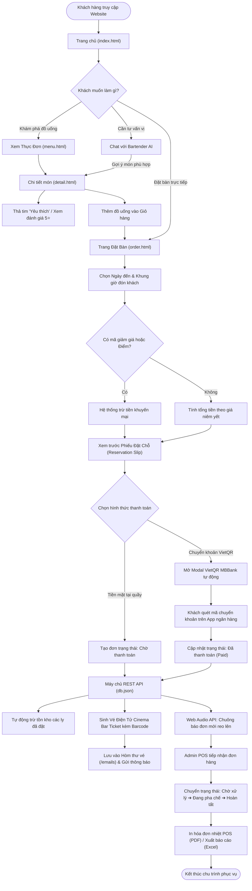
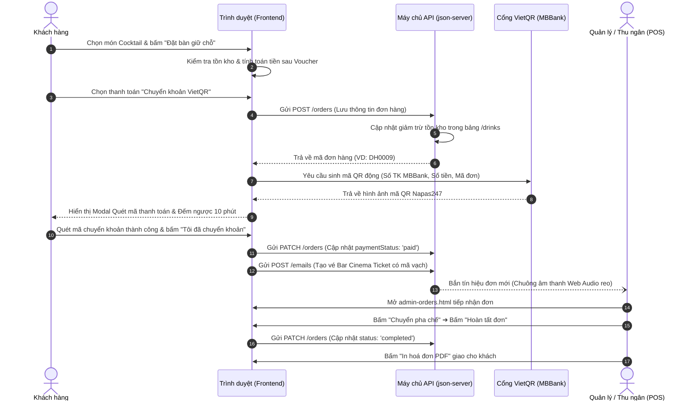
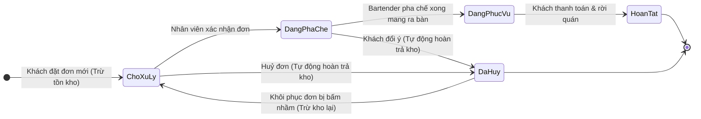
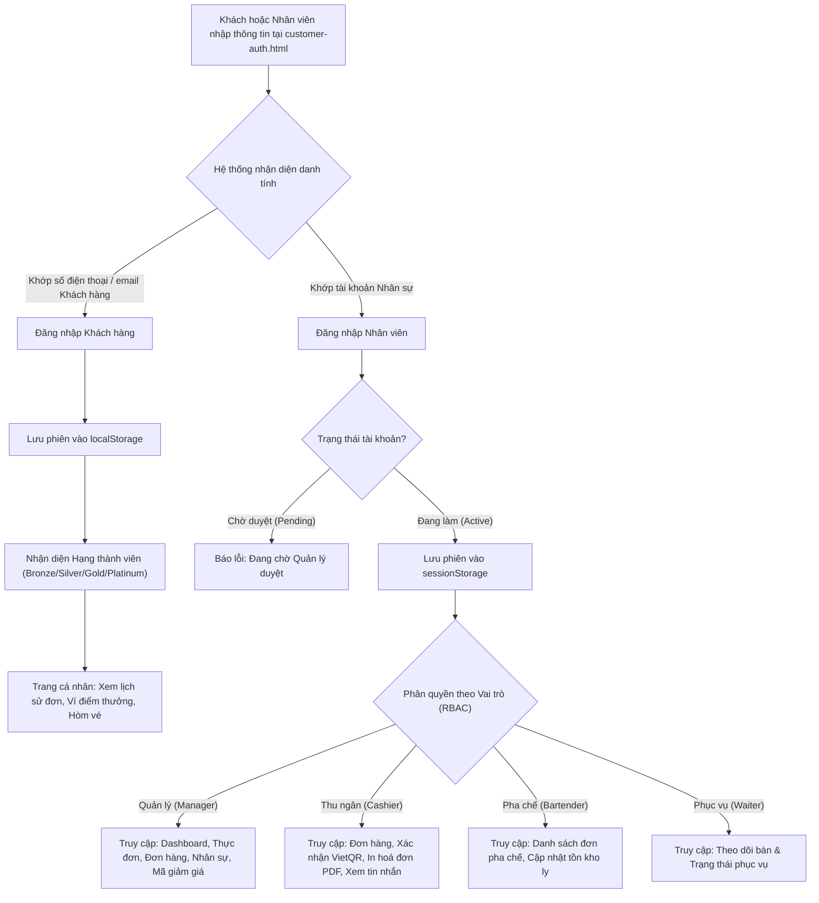

# 🍸 SƠ ĐỒ QUY TRÌNH HOẠT ĐỘNG (SYSTEM WORKFLOW)
## HỆ THỐNG QUẢN LÝ & ĐẶT BÀN QUÁN BAR ĐÊM (ARTISAN SPEAKEASY LOUNGE)

---

## 1. SƠ ĐỒ TỔNG THỂ TOÀN BỘ QUY TRÌNH (END-TO-END MASTER FLOW)

---

## 2. QUY TRÌNH CHI TIẾT TƯƠNG TÁC HỆ THỐNG (SEQUENCE WORKFLOW)

Sơ đồ tuần tự thể hiện dòng chảy dữ liệu giữa **Khách hàng ➔ Giao diện Trình duyệt ➔ Máy chủ API ➔ Cổng VietQR ➔ Quản trị viên**:

---

## 3. QUY TRÌNH VÒNG ĐỜI ĐƠN HÀNG & BẢO VỆ TỒN KHO (ORDER STATE MACHINE)

Đảm bảo số lượng ly tồn kho luôn chính xác 100%, không xảy ra tình trạng "bán khống" hoặc mất dữ liệu khi huỷ đơn:

### Các nguyên tắc xử lý tồn kho:
1. **Khi đặt đơn:** Tồn kho ly `stock` giảm ngay lập tức. Nếu `stock = 0`, trạng thái món tự động chuyển sang `soldout`.
2. **Khi huỷ đơn (Cancelled):** Tồn kho tự động được hoàn trả đúng số ly. Món hết hàng sẽ tự động mở bán lại thành `available`.
3. **Khi xoá đơn:**
   - Đơn đang chờ / chưa phục vụ: Tự động hoàn kho trước khi xoá.
   - Đơn đã **Hoàn tất (Completed)**: Không hoàn kho để đảm bảo tính toàn vẹn doanh thu lịch sử.

---

## 4. QUY TRÌNH PHÂN QUYỀN MỘT CỬA (UNIFIED AUTH & RBAC WORKFLOW)

---

## 5. BẢNG TỔNG HỢP CÁC BƯỚC THAO TÁC CỦA MỘT SAMPLE MẪU (STEP-BY-STEP SAMPLE)

| Giai đoạn | Đối tượng | Hành động | Trang / Module liên quan | Dữ liệu đầu ra |
|---|---|---|---|---|
| **1. Khám phá** | Khách hàng | Tìm kiếm cocktail vị khói, xem nồng độ ABV, thả tim món | `menu.html`, `detail.html`, `drinkCard.js` | Thêm vào mảng `favorites` |
| **2. Tư vấn** | Khách hàng | Hỏi trợ lý ảo: *"Gợi ý cho tôi món thanh mát nhẹ độ"* | `chatbot.js`, `chatbotService.js` | Chatbot tư vấn đúng món trong thực đơn |
| **3. Chọn chỗ** | Khách hàng | Chọn ngày đến, chọn nút khung giờ `20:00`, chọn bàn Bar | `order.html`, `order.js` | Tạo đối tượng `Order` (kế thừa `BookingOrder`) |
| **4. Ưu đãi** | Khách hàng | Nhập mã giảm giá hoặc dùng điểm tích lũy thành viên | `voucherService.js`, `customerAuth.js` | Tính giảm trừ hiển thị trên Phiếu Đặt Chỗ |
| **5. Trả tiền** | Khách hàng | Quét mã MBBank và bấm "Tôi đã chuyển khoản" | `vietqrService.js`, Cổng VietQR MBBank | `paymentStatus = 'paid'` |
| **6. Nhận vé** | Khách hàng | Xem vé điện tử Bar Cinema Ticket có mã vạch | `emailService.js`, bảng `/emails` | Vé điện tử lưu trong hòm thư |
| **7. Báo đơn** | Hệ thống | Phát chuông âm thanh cảnh báo đơn mới | `notificationService.js` (Web Audio API) | Âm thanh `ding-dong` sang trọng phát ra |
| **8. Quản trị** | Nhân viên | Tiếp nhận đơn, xác nhận, chuyển trạng thái pha chế | `admin-orders.html`, `ordersService.js` | `status = 'preparing' ➔ 'completed'` |
| **9. In & Xuất** | Thu ngân | In hóa đơn thanh toán PDF & Xuất báo cáo Excel | `exportService.js` | File `.csv` UTF-8 BOM và cửa sổ in POS |
