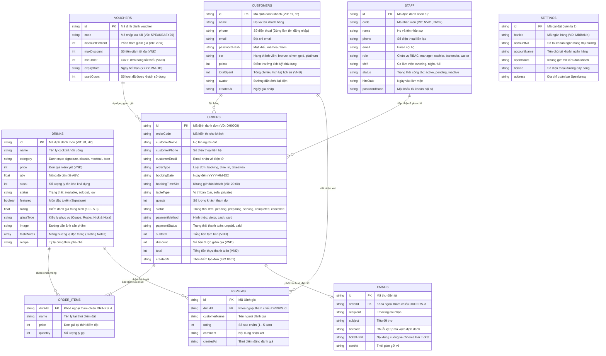

# 🗄️ TÀI LIỆU THIẾT KẾ CƠ SỞ DỮ LIỆU (DATABASE DESIGN SPECIFICATION)
## HỆ THỐNG QUẢN LÝ & ĐẶT BÀN QUÁN BAR ĐÊM (ARTISAN SPEAKEASY LOUNGE)

> **Môn học:** Lập trình Web / JavaScript Nâng Cao  
> **Tài liệu:** Bài tập 3 — Thiết kế Database & Từ điển dữ liệu (Data Dictionary)  
> **Hệ quản trị:** json-server REST API (Flat-file Document Database: `db.json`) + Client Web Storage (`localStorage` / `sessionStorage`)  
> **Phiên bản:** 2.0.0

---

## 1. TỔNG QUAN CƠ SỞ DỮ LIỆU

Hệ thống lưu trữ dữ liệu tập trung trong tệp tin **`db.json`**, được động cơ **json-server** giả lập thành một hệ quản trị cơ sở dữ liệu RESTful API hoàn chỉnh. 

### 1.1. Đặc điểm cấu trúc
- **Mô hình dữ liệu:** Dạng tài liệu NoSQL / Document-based JSON phân cấp.
- **Tính toàn vẹn tham chiếu:** Các mối quan hệ 1-N (One-to-Many) và 1-1 (One-to-One) được liên kết thông qua các khoá ngoại logic (VD: `drinkId`, `orderId`, `customerId`).
- **Chiến lược hai tầng lưu trữ (Two-Tier Persistence):**
  1. **Server Storage (`db.json`):** Lưu trữ toàn bộ dữ liệu chung của quán (Thực đơn, Đơn hàng, Nhân sự, Khách hàng, Đánh giá, Vé điện tử).
  2. **Client Storage:** 
     - `localStorage`: Lưu trữ giỏ hàng hiện tại (`quanbar_cart`), danh sách yêu thích (`quanbar_favorites`) và bản sao đệm đọc ngoại tuyến (`quanbar_cache_*`).
     - `sessionStorage`: Lưu phiên làm việc của nhân viên quản trị (`current_admin`), tự động xoá khi đóng tab để bảo mật quầy POS.

---

## 2. SƠ ĐỒ THỰC THỂ LIÊN KẾT (ENTITY-RELATIONSHIP DIAGRAM - ERD)



---

## 3. TỪ ĐIỂN DỮ LIỆU CHI TIẾT (DATA DICTIONARY)

### 3.1. Bảng `drinks` (Danh mục đồ uống & Cocktail)

| Tên trường (Field) | Kiểu dữ liệu | Khóa | Bắt buộc | Mặc định | Ý nghĩa & Quy tắc nghiệp vụ |
|---|---|:---:|:---:|---|---|
| `id` | `String` | **PK** | Có | Tự sinh | Định danh duy nhất món đồ uống (VD: `d1`, `d2`...). |
| `name` | `String` | | Có | None | Tên thương phẩm của ly cocktail (VD: *Negroni*, *Old Fashioned*). |
| `category` | `String` | | Có | None | Danh mục phân loại: `signature`, `classic`, `mocktail`, `beer`. |
| `price` | `Number` | | Có | 0 | Giá bán niêm yết (VNĐ), phải là số nguyên dương $\ge 0$. |
| `abv` | `Number` | | Có | 0 | Nồng độ cồn (% Alcohol by Volume), khoảng từ `0.0` đến `100.0`. |
| `stock` | `Number` | | Có | 0 | Số lượng ly khả dụng trong kho, giảm khi đặt, tăng khi hoàn kho. |
| `status` | `String` | | Có | `"available"` | Trạng thái món: `available` (Còn hàng), `soldout` (Hết), `low` (Sắp hết). |
| `featured` | `Boolean` | | Không | `false` | Đánh dấu món đặc tuyển Signature hiển thị trang chủ. |
| `rating` | `Number` | | Không | 5.0 | Điểm đánh giá trung bình của món (1.0 đến 5.0). |
| `glassType` | `String` | | Không | `""` | Kiểu ly chuẩn phục vụ: *Coupe*, *Rocks*, *Highball*, *Martini*... |
| `image` | `String` | | Không | `""` | Đường dẫn tệp ảnh sản phẩm (`img/drinks/...`). |
| `tasteNotes` | `Array<String>` | | Không | `[]` | Mảng các thẻ hương vị đặc trưng (VD: `["Đậm đà", "Khói sồi", "Chát nhẹ"]`). |
| `recipe` | `String` | | Không | `""` | Tỷ lệ công thức pha chế (VD: *30ml Gin, 30ml Campari, 30ml Sweet Vermouth*). |

---

### 3.2. Bảng `orders` (Đơn đặt bàn & Gọi món)

| Tên trường (Field) | Kiểu dữ liệu | Khóa | Bắt buộc | Mặc định | Ý nghĩa & Quy tắc nghiệp vụ |
|---|---|:---:|:---:|---|---|
| `id` | `String` | **PK** | Có | Tự sinh | Mã định danh đơn hàng trên hệ thống máy chủ (VD: `DH0009`). |
| `orderCode` | `String` | | Có | None | Mã đơn hàng hiển thị cho khách tra cứu. |
| `customerName` | `String` | | Có | None | Họ và tên khách hàng đại diện đặt bàn. |
| `customerPhone`| `String` | | Có | None | Số điện thoại dùng để nhận diện và tra cứu đơn. |
| `customerEmail`| `String` | | Không | `""` | Email khách để nhận vé điện tử Bar Cinema Ticket. |
| `orderType` | `String` | | Có | `"booking"` | Phân loại đơn: `booking` (Đặt trước), `dine_in` (Tại quán), `takeaway`. |
| `bookingDate` | `String` | | Không | `""` | Ngày hẹn đến quán (Định dạng `YYYY-MM-DD`). |
| `bookingTimeSlot`| `String`| | Không | `""` | Khung giờ đón khách: `18:00`, `19:00`, `20:00`, `21:00`, `22:00`... |
| `tableType` | `String` | | Không | `"bar"` | Vị trí khu vực ngồi: `bar` (Quầy Bar), `sofa` (Khu Sofa), `private`. |
| `guests` | `Number` | | Không | 2 | Số lượng khách dự kiến tham gia. |
| `items` | `Array<Object>`| | Có | `[]` | Mảng chi tiết từng món: `{ drinkId, name, price, quantity }`. |
| `status` | `String` | | Có | `"pending"` | Máy trạng thái: `pending`, `preparing`, `serving`, `completed`, `cancelled`. |
| `paymentMethod`| `String` | | Có | `"vietqr"` | Phương thức thanh toán: `vietqr` (Chuyển khoản), `cash` (Tiền mặt). |
| `paymentStatus`| `String` | | Có | `"unpaid"` | Tình trạng thanh toán: `unpaid` (Chưa trả), `paid` (Đã thanh toán). |
| `subtotal` | `Number` | | Có | 0 | Tổng giá trị đồ uống trước khi giảm giá (VNĐ). |
| `discount` | `Number` | | Không | 0 | Số tiền được giảm trừ qua Voucher hoặc Điểm thưởng (VNĐ). |
| `total` | `Number` | | Có | 0 | Tổng tiền cuối cùng khách phải thanh toán (VNĐ). |
| `createdAt` | `String` | | Có | ISO Now | Dấu mốc thời gian tạo đơn hàng. |

---

### 3.3. Bảng `customers` (Khách hàng thành viên)

| Tên trường (Field) | Kiểu dữ liệu | Khóa | Bắt buộc | Mặc định | Ý nghĩa & Quy tắc nghiệp vụ |
|---|---|:---:|:---:|---|---|
| `id` | `String` | **PK** | Có | Tự sinh | Định danh khách hàng (VD: `c1`, `c2`). |
| `name` | `String` | | Có | None | Họ và tên đầy đủ của khách hàng. |
| `phone` | `String` | | Có | None | Số điện thoại duy nhất, dùng làm tên đăng nhập. |
| `email` | `String` | | Không | `""` | Email liên lạc nhận vé và thông báo ưu đãi. |
| `passwordHash` | `String` | | Có | None | Mật khẩu xác thực tài khoản. |
| `tier` | `String` | | Có | `"bronze"` | Hạng thẻ: `bronze` (Đồng), `silver` (Bạc), `gold` (Vàng), `platinum` (Bạch kim). |
| `points` | `Number` | | Có | 0 | Điểm thưởng tích luỹ (1 điểm = 1.000đ khi thanh toán). |
| `totalSpent` | `Number` | | Có | 0 | Tổng số tiền đã chi tiêu lịch sử để xét nâng hạng. |
| `avatar` | `String` | | Không | `""` | Đường dẫn hoặc ảnh Base64 đại diện của khách. |

---

### 3.4. Bảng `staff` (Hồ sơ nhân sự quán Bar)

| Tên trường (Field) | Kiểu dữ liệu | Khóa | Bắt buộc | Mặc định | Ý nghĩa & Quy tắc nghiệp vụ |
|---|---|:---:|:---:|---|---|
| `id` | `String` | **PK** | Có | Tự sinh | Định danh duy nhất của nhân sự. |
| `code` | `String` | | Có | None | Mã nhân viên nội bộ (VD: `NV01`, `NV02`...). |
| `name` | `String` | | Có | None | Họ và tên nhân viên. |
| `phone` | `String` | | Có | None | Số điện thoại dùng để đăng nhập hệ thống. |
| `email` | `String` | | Không | `""` | Email liên hệ công việc nội bộ. |
| `role` | `String` | | Có | `"waiter"` | Quyền hạn RBAC: `manager` (Quản lý), `cashier`, `bartender`, `waiter`. |
| `shift` | `String` | | Có | `"evening"`| Ca phân bổ trực: `evening` (18h-22h), `night` (22h-02h), `full`. |
| `status` | `String` | | Có | `"pending"` | Trạng thái: `pending` (Chờ duyệt), `active` (Đang làm), `inactive` (Nghỉ). |
| `hireDate` | `String` | | Không | `""` | Ngày chính thức vào làm việc (YYYY-MM-DD). |
| `passwordHash` | `String` | | Có | None | Mật khẩu tài khoản nội bộ. |

---

### 3.5. Bảng `vouchers` (Mã giảm giá & Khuyến mãi)

| Tên trường (Field) | Kiểu dữ liệu | Khóa | Bắt buộc | Mặc định | Ý nghĩa & Quy tắc nghiệp vụ |
|---|---|:---:|:---:|---|---|
| `id` | `String` | **PK** | Có | Tự sinh | Định danh bản ghi voucher. |
| `code` | `String` | | Có | None | Mã ký tự nhập ưu đãi (VD: `SPEAKEASY20`, `WELCOME50`). |
| `discountPercent`| `Number` | | Có | 0 | Tỷ lệ giảm giá (%) (VD: `10`, `20`). |
| `maxDiscount` | `Number` | | Có | 0 | Mức giảm tối đa cho phép (VNĐ). |
| `minOrder` | `Number` | | Có | 0 | Giá trị đơn hàng tối thiểu cần đạt để áp dụng mã. |
| `expiryDate` | `String` | | Có | None | Ngày hết hạn hiệu lực của mã (YYYY-MM-DD). |
| `usedCount` | `Number` | | Không | 0 | Số lần mã đã được sử dụng thực tế. |

---

### 3.6. Bảng `reviews` (Đánh giá & Bình luận đồ uống)

| Tên trường (Field) | Kiểu dữ liệu | Khóa | Bắt buộc | Mặc định | Ý nghĩa & Quy tắc nghiệp vụ |
|---|---|:---:|:---:|---|---|
| `id` | `String` | **PK** | Có | Tự sinh | Định danh bài đánh giá. |
| `drinkId` | `String` | **FK** | Có | None | Tham chiếu trực tiếp đến `drinks.id`. |
| `customerName` | `String` | | Có | None | Tên người đăng bài đánh giá. |
| `rating` | `Number` | | Có | 5 | Số sao chấm, nhận giá trị nguyên từ `1` đến `5`. |
| `comment` | `String` | | Có | None | Nội dung nhận xét chi tiết của khách hàng. |
| `createdAt` | `String` | | Có | ISO Now | Thời gian gửi bình luận. |

---

### 3.7. Bảng `emails` (Hòm thư phát hành Vé điện tử)

| Tên trường (Field) | Kiểu dữ liệu | Khóa | Bắt buộc | Mặc định | Ý nghĩa & Quy tắc nghiệp vụ |
|---|---|:---:|:---:|---|---|
| `id` | `String` | **PK** | Có | Tự sinh | Định danh email vé phát hành. |
| `orderId` | `String` | **FK** | Có | None | Tham chiếu đến đơn hàng `orders.id`. |
| `recipient` | `String` | | Có | None | Địa chỉ email người nhận vé. |
| `subject` | `String` | | Có | None | Tiêu đề thông báo xác nhận vé. |
| `barcode` | `String` | | Có | None | Chuỗi ký tự mã vạch định danh vé. |
| `ticketHtml` | `String` | | Có | None | Toàn bộ mã HTML cuống vé Cinema Bar Ticket kèm Barcode SVG. |
| `sentAt` | `String` | | Có | ISO Now | Thời gian phát hành vé. |

---

### 3.8. Bảng `settings` (Cấu hình thông tin quán & Cổng VietQR)

| Tên trường (Field) | Kiểu dữ liệu | Khóa | Bắt buộc | Ý nghĩa & Quy tắc nghiệp vụ |
|---|---|:---:|:---:|---|
| `id` | `Number` | **PK** | Có | Khóa định danh duy nhất (luôn mang giá trị `1`). |
| `bankId` | `String` | | Có | Mã định danh ngân hàng nhận tiền chuyển khoản (Mặc định: `MBBANK`). |
| `accountNo` | `String` | | Có | Số tài khoản ngân hàng thụ hưởng (VD: `0334808381`). |
| `accountName` | `String` | | Có | Tên chủ tài khoản ngân hàng thụ hưởng. |
| `openHours` | `String` | | Có | Khung giờ hoạt động tiếp khách (VD: `18:00 - 02:00`). |
| `hotline` | `String` | | Có | Số điện thoại đường dây nóng hỗ trợ khách. |
| `address` | `String` | | Có | Địa chỉ thực tế của quán Bar (VD: *74-76 Nam Kỳ Khởi Nghĩa, Q.1*). |

---

## 4. QUY TẮC RÀNG BUỘC TOÀN VẸN NGHIỆP VỤ (INTEGRITY CONSTRAINTS)

1. **Ràng buộc tồn kho không âm ($stock \ge 0$):**
   - Khi khách đặt đơn, hệ thống kiểm tra: `drink.stock >= item.quantity`.
   - Nếu số lượng yêu cầu vượt quá tồn kho, giỏ hàng tự động bị hạ về bằng đúng số lượng tồn kho còn lại.
2. **Ràng buộc tính toàn vẹn hoàn kho:**
   - Khi đơn ở trạng thái `pending` hoặc `preparing` bị huỷ (`cancelled`) hoặc xoá (`delete`): Hệ thống duyệt từng món trong `order.items` và cộng bù lại `drink.stock += item.quantity`.
   - Đối với đơn đã `completed`: Tuyệt đối không hoàn kho khi xoá để đảm bảo tính bất biến của doanh thu lịch sử.
3. **Ràng buộc phân quyền RBAC:**
   - Nhân viên ở trạng thái `pending` tuyệt đối không được cấp quyền đăng nhập vào bất kỳ trang quản trị nào cho đến khi Quản lý phê duyệt sang `active`.

---

## 5. DỮ LIỆU MẪU JSON MINH HỌA (SAMPLE JSON RECORDS)

### Mẫu bản ghi đồ uống (`drinks`):
```json
{
  "id": "d1",
  "name": "Negroni Speakeasy",
  "category": "signature",
  "price": 145000,
  "abv": 24.0,
  "stock": 15,
  "status": "available",
  "featured": true,
  "rating": 4.9,
  "glassType": "Rocks Glass",
  "image": "img/drinks/negroni.jpg",
  "tasteNotes": ["Đậm đà", "Đắng thảo mộc", "Vỏ cam ấm"],
  "recipe": "30ml Tanqueray London Dry Gin, 30ml Campari, 30ml Carpano Antica Sweet Vermouth"
}
```

### Mẫu bản ghi đơn hàng (`orders`):
```json
{
  "id": "DH0009",
  "orderCode": "DH0009",
  "customerName": "Lê Hoàng Minh",
  "customerPhone": "0912345678",
  "customerEmail": "hoangminh@gmail.com",
  "orderType": "booking",
  "bookingDate": "2026-11-06",
  "bookingTimeSlot": "20:00",
  "tableType": "bar",
  "guests": 2,
  "items": [
    { "drinkId": "d1", "name": "Negroni Speakeasy", "price": 145000, "quantity": 2 }
  ],
  "status": "pending",
  "paymentMethod": "vietqr",
  "paymentStatus": "paid",
  "subtotal": 290000,
  "discount": 29000,
  "total": 261000,
  "createdAt": "2026-11-05T13:30:00.000Z"
}
```

---
*Tài liệu thuộc bộ hồ sơ kỹ thuật đồ án Quán Bar Đêm.*

