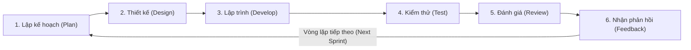

# 🏃‍♂️ TỔNG QUAN PHƯƠNG PHÁP PHÁT TRIỂN PHẦN MỀM AGILE

## 1. AGILE LÀ GÌ?
**Agile** là phương pháp phát triển phần mềm linh hoạt, tập trung vào việc cung cấp giá trị nhanh chóng và liên tục cho khách hàng thông qua các vòng lặp phát triển ngắn (Iterations / Sprints từ 1 đến 4 tuần).  
Agile nhấn mạnh sự hợp tác, phản hồi liên tục và khả năng thích ứng linh hoạt với thay đổi trong suốt quá trình phát triển phần mềm.

### So sánh Waterfall vs Agile:
| Tiêu chí | Mô hình Waterfall (Thác nước) | Phương pháp Agile (Linh hoạt) |
|---|---|---|
| **Cách tiếp cận** | Tuần tự, bám chặt kế hoạch ban đầu: Phân tích ➔ Thiết kế ➔ Lập trình ➔ Kiểm thử ➔ Bàn giao. | Chia nhỏ dự án thành nhiều vòng lặp ngắn (Sprint 1-2 tuần). |
| **Phản hồi từ khách** | Chỉ nhận phản hồi khi đã xong 100% dự án (dễ bị lệch nhu cầu). | Khách hàng xem thử và góp ý liên tục sau mỗi Sprint. |
| **Khả năng thay đổi** | Rất khó và tốn kém khi thay đổi yêu cầu ở giai đoạn muộn. | Chào đón thay đổi yêu cầu kể cả ở giai đoạn cuối. |
| **Thước đo tiến độ** | Dựa trên tài liệu và các mốc thời gian hoàn thành. | Dựa trên **phần mềm hoạt động thực tế (Working software)**. |

---

## 2. BỐN GIÁ TRỊ CỐT LÕI CỦA AGILE (AGILE MANIFESTO)
1. **Cá nhân và sự tương tác** HƠN LÀ quy trình và công cụ.
2. **Phần mềm hoạt động tốt** HƠN LÀ tài liệu đầy đủ, cồng kềnh.
3. **Hợp tác với khách hàng** HƠN LÀ đàm phán hợp đồng cứng nhắc.
4. **Phản hồi với sự thay đổi** HƠN LÀ bám sát theo kế hoạch cố định.

---

## 3. MƯỜI HAI NGUYÊN TẮC CỦA AGILE
1. Ưu tiên cao nhất là làm hài lòng khách hàng thông qua việc bàn giao phần mềm có giá trị sớm và liên tục.
2. Chào đón các yêu cầu thay đổi, ngay cả trong giai đoạn muộn của quá trình phát triển.
3. Bàn giao phần mềm hoạt động thường xuyên, từ vài tuần đến vài tháng, ưu tiên khoảng thời gian ngắn hơn.
4. Các nhà kinh doanh và các nhà phát triển phải làm việc cùng nhau hàng ngày trong suốt dự án.
5. Xây dựng các dự án xung quanh các cá nhân có động lực. Cung cấp môi trường và hỗ trợ cần thiết, đồng thời tin tưởng họ để hoàn thành công việc.
6. Phương pháp hiệu quả và năng suất nhất để truyền đạt thông tin trong nhóm phát triển là trò chuyện trực tiếp (Face-to-face).
7. Phần mềm hoạt động tốt là thước đo chính của tiến độ dự án.
8. Các quy trình Agile thúc đẩy sự phát triển bền vững. Các nhà tài trợ, nhà phát triển và người dùng cần duy trì nhịp độ làm việc ổn định lâu dài.
9. Liên tục chú ý đến kỹ thuật xuất sắc và thiết kế tốt để tăng cường tính linh hoạt.
10. Sự đơn giản – nghệ thuật tối đa hóa lượng công việc chưa cần làm – là điều cốt yếu.
11. Các kiến trúc, yêu cầu và thiết kế tốt nhất xuất hiện từ các nhóm tự tổ chức (Self-organizing teams).
12. Định kỳ đều đặn, nhóm phát triển suy ngẫm về cách làm việc hiệu quả hơn, sau đó điều chỉnh và tinh chỉnh hành vi của mình cho phù hợp (Sprint Retrospective).

