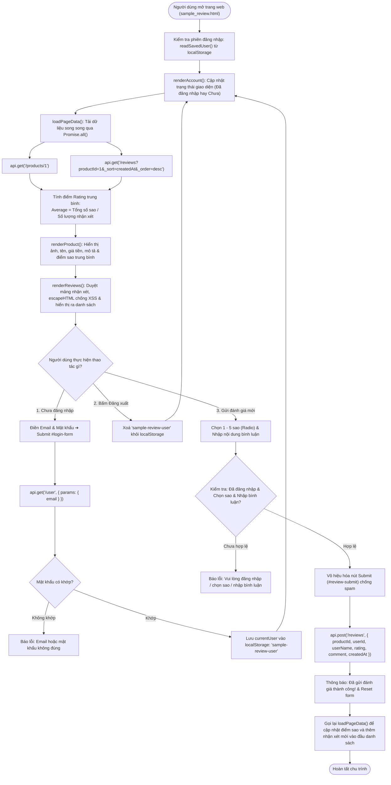
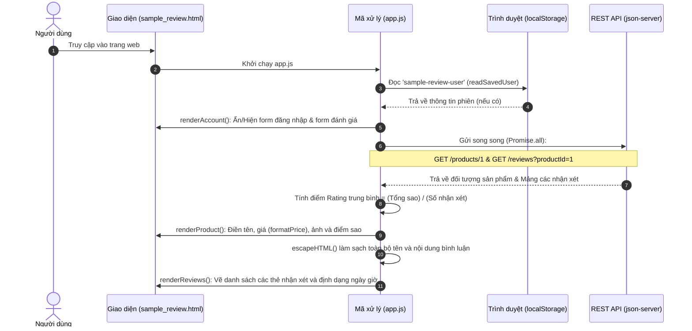
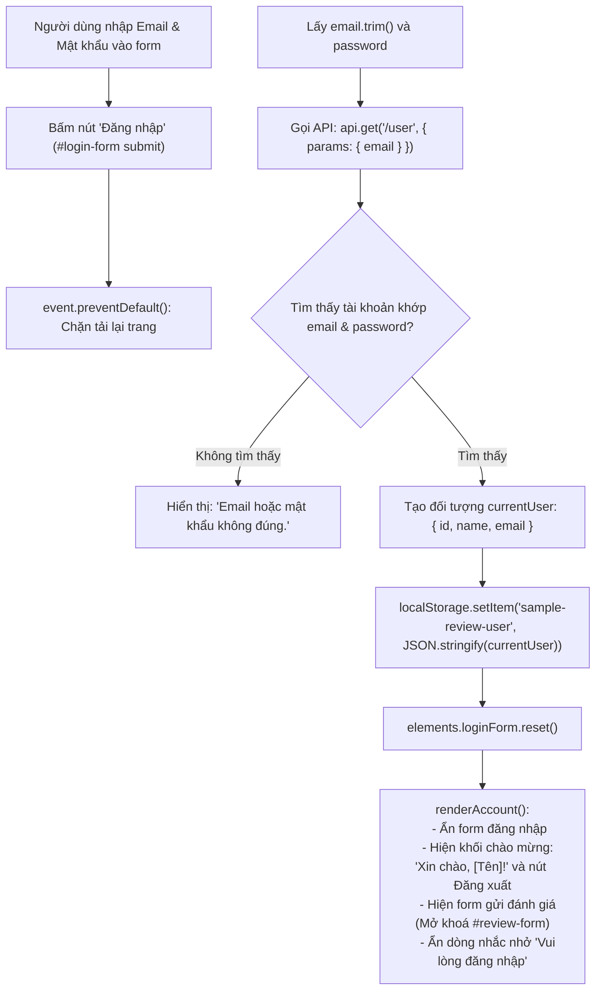
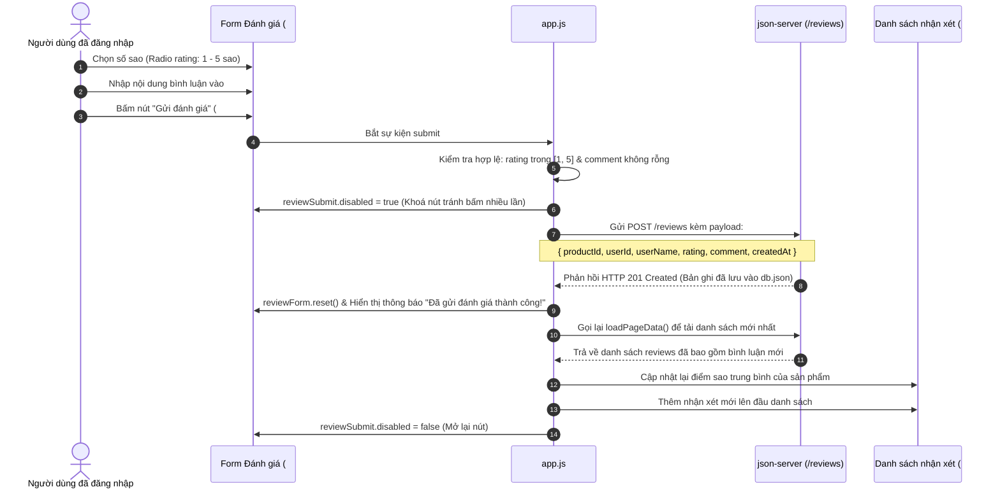
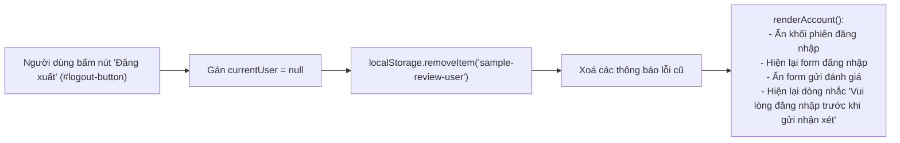

# 🔄 SƠ ĐỒ WORKFLOW CHO SAMPLE ĐƠN GIẢN CỦA WEB APPLICATION
## TÍNH NĂNG CHI TIẾT SẢN PHẨM & ĐÁNH GIÁ (PRODUCT DETAIL & REVIEW SYSTEM)

> **Mô hình triển khai:** Mã nguồn `app.js` & giao diện `sample_review.html`  
> **Giao thức:** RESTful API qua thư viện Axios  
> **Lưu trữ phiên:** `localStorage` (`sample-review-user`)  
> **Ngôn ngữ định dạng:** GitHub Markdown kết hợp Mermaid Diagrams chuẩn.

---

## 1. SƠ ĐỒ LUỒNG TỔNG THỂ (OVERALL MASTER FLOWCHART)

Sơ đồ thể hiện toàn bộ vòng đời hoạt động từ khi người dùng mở trang web, đăng nhập cho đến khi gửi đánh giá sao và hiển thị nhận xét:

---

## 2. WORKFLOW 1: TẢI TRANG & HIỂN THỊ DỮ LIỆU BAN ĐẦU (PAGE LOAD FLOW)

Quy trình tuần tự giữa Trình duyệt và Máy chủ REST API khi người dùng mới mở trang:

---

## 3. WORKFLOW 2: QUY TRÌNH ĐĂNG NHẬP THÀNH VIÊN (USER LOGIN FLOW)

---

## 4. WORKFLOW 3: QUY TRÌNH GỬI ĐÁNH GIÁ 5 SAO & BÌNH LUẬN (REVIEW SUBMISSION FLOW)

---

## 5. WORKFLOW 4: QUY TRÌNH ĐĂNG XUẤT (LOGOUT FLOW)

---

## 6. BẢNG TỔNG HỢP ÁNH XẠ GIỮA LUỒNG NGHIỆP VỤ VÀ MÃ NGUỒN `app.js`

| Luồng nghiệp vụ | Hàm / Biến trong mã `app.js` | Cơ chế kỹ thuật |
|---|---|---|
| **Đọc phiên khi mở trang** | `readSavedUser()` | `localStorage.getItem("sample-review-user")` + `JSON.parse` có bọc `try/catch`. |
| **Bảo vệ chống XSS** | `escapeHTML(value)` | Thay thế các ký tự nguy hiểm `&`, `<`, `>`, `"`, `'` thành HTML entities tương ứng. |
| **Định dạng tiền tệ** | `formatPrice(price)` | `Intl.NumberFormat("vi-VN")` ➔ Thêm đuôi `" đ"`. |
| **Định dạng ngày giờ** | `formatDate(dateString)` | `Intl.DateTimeFormat("vi-VN", { dateStyle: "medium", timeStyle: "short" })`. |
| **Tải dữ liệu song song** | `loadPageData()` | `Promise.all([api.get("/products/1"), api.get("/reviews")])`. |
| **Tính sao trung bình** | `renderProduct()` | `reviews.reduce(...) / reviews.length` ➔ hiển thị với `toFixed(1)`. |
| **Chuyển đổi giao diện Auth** | `renderAccount()` | Thay đổi thuộc tính `.hidden` của `#login-form` và `#review-form`. |
| **Vẽ danh sách bình luận** | `renderReviews()` | Dùng `Array.map` tạo chuỗi HTML, lặp ký tự `"★"` và `"☆"`. |
| **Gửi đánh giá lên máy chủ** | `reviewForm.addEventListener` | `new FormData()`, gọi `api.post("/reviews")` với `createdAt: new Date().toISOString()`. |

---
*Tài liệu workflow mẫu hoàn chỉnh cho tệp mã nguồn app.js và giao diện sample_review.html.*

