# 🔄 TÀI LIỆU THIẾT KẾ WORKFLOW HỆ THỐNG (WORKFLOW.MD)
## HỆ THỐNG QUẢN LÝ & ĐẶT BÀN QUÁN BAR ĐÊM (ARTISAN SPEAKEASY LOUNGE)

> **Môn học:** Lập trình Web / JavaScript Nâng Cao  
> **Tài liệu:** Bài tập 2 — Vẽ Workflow cho từng chức năng của hệ thống  
> **Định dạng:** Markdown kết hợp Mermaid Diagrams và Bảng đặc tả luồng thao tác.  
>
> 📋 **CẤU TRÚC TÀI LIỆU (2 PHẦN TOÀN DIỆN):**  
> - **PHẦN 1: BẢN THIẾT KẾ KHỞI NGUYÊN TỪ CON SỐ 0 (DAY 0 BLUEPRINT — VẼ TRƯỚC KHI CODE):** 4 sơ đồ nền móng định hình dữ liệu Ngoài - Trong, Hành trình khách hàng 5 bước, Cỗ máy trạng thái kho và Phân quyền một cửa.  
> - **PHẦN 2: CHI TIẾT 19 WORKFLOW TỪNG CHỨC NĂNG HỆ THỐNG (F01 ĐẾN F18 — ĐẶC TẢ KỸ THUẬT KHI LẬP TRÌNH):** Sơ đồ Master End-to-End và 18 workflow chuyên sâu cho từng màn hình và service.

---

# 🎨 PHẦN 1: BẢN THIẾT KẾ WORKFLOW BAN ĐẦU TỪ CON SỐ 0 (DAY 0 BLUEPRINT)
*(Bản vẽ trên giấy trắng trước khi bắt tay vào lập trình)*

> **Tình huống giả định:** Hệ thống chưa hề tồn tại, chưa có một dòng code, chưa có db.json.  
> **Mục tiêu:** Là một Kỹ sư phần mềm / Solution Architect, ngồi xuống với một tờ giấy trắng để vẽ toàn bộ luồng nghiệp vụ (Workflow) từ con số 0, từ đó mới bắt tay vào code và xây dựng nên đồ án này.

## 1. BƯỚC ĐẦU TIÊN: ĐỀ BÀI TỪ CHỦ QUÁN BAR (PROBLEM STATEMENT)

Chủ quán Bar Đêm đến gặp bạn và nói:
> *"Tôi muốn mở một quán Cocktail Bar Speakeasy cao cấp. Tôi muốn có một website để:*
> 1. *Khách lên mạng xem được thực đơn chuẩn quốc tế, biết nồng độ cồn ABV, hương vị, đặt trước bàn theo khung giờ tối, trả tiền quét mã QR ngân hàng và có vé điện tử vào cửa.*
> 2. *Quán tôi có Phục vụ, Pha chế, Thu ngân và tôi là Quản lý. Làm sao để khi khách đặt món thì kho rượu tự động trừ, nhân viên biết đường pha chế, thu ngân in được bill, không bị mất tiền và thất thoát tồn kho?"*

Từ bài toán trên, ta không vội mở máy tính lên code HTML/CSS ngay, mà phải **vẽ ra 4 sơ đồ Workflow cốt lõi** để định hình toàn bộ dự án.

---

## 2. WORKFLOW 1: BỨC TRANH TOÀN CẢNH (BIG PICTURE ARCHITECTURE)

Ta chia hệ thống thành **2 thế giới** gặp nhau ở **Chiếc Đơn Hàng & Vé Điện Tử**:

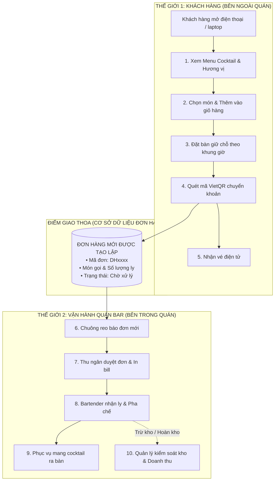

---

## 3. WORKFLOW 2: TRẢI NGHIỆM KHÁCH HÀNG TỪ A ĐẾN Z (CUSTOMER JOURNEY)

Ta vẽ chi tiết từng bước mà một vị khách sẽ trải qua trên website để biết mình cần làm những trang HTML nào:

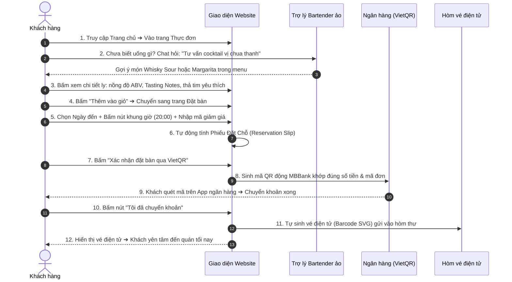

---

## 4. WORKFLOW 3: THIẾT KẾ CỖ MÁY TRẠNG THÁI & BẢO VỆ TỒN KHO (STATE MACHINE & INVENTORY)

Đây là bài toán nghiệp vụ hóc búa nhất: **Làm sao để rượu không bị thất thoát khi khách huỷ bàn hoặc đổi ý?**

Ta vẽ ra quy tắc chuyển đổi trạng thái nghiêm ngặt trước khi viết code:

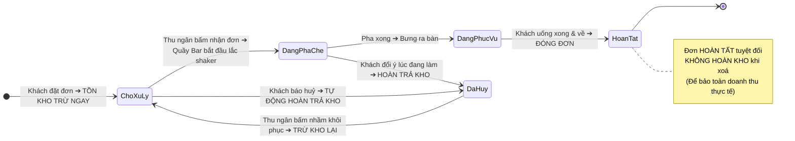

---

## 5. WORKFLOW 4: DÒNG CHẢY DỮ LIỆU ĐĂNG NHẬP & PHÂN QUYỀN (UNIFIED RBAC)

Ta không muốn làm 2 trang đăng nhập riêng biệt (quản trị riêng, khách riêng) vì người dùng sẽ bị rối.  
Ta vẽ ra luồng **"Đăng nhập một cửa thông minh"**:

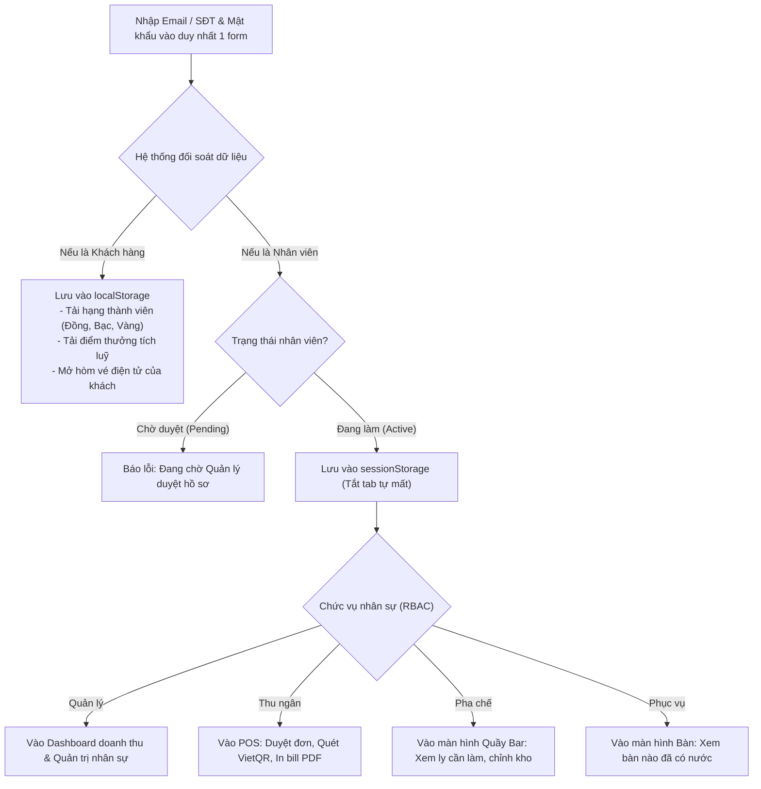

---

## 6. BƯỚC ĐỘT PHÁ: TỪ WORKFLOW NÀY SUY RA MỌI THỨ CẦN LẬP TRÌNH!

Sau khi vẽ xong 4 sơ đồ Workflow trên, ta lập tức có câu trả lời rõ như ban ngày cho toàn bộ dự án:

### 1. Ta cần tạo những trang HTML nào? (Nhìn từ Workflow 1 & 2):
- Khách cần xem menu ➔ Cần file `menu.html` & `detail.html`.
- Khách cần đặt bàn ➔ Cần file `order.html`.
- Khách cần xem vé ➔ Cần file `customer-account.html`.
- Thu ngân cần xử lý đơn ➔ Cần file `admin-orders.html`.
- Quản lý cần xem biểu đồ ➔ Cần file `admin-dashboard.html`.
- Pha chế & quản lý cần kho ➔ Cần file `admin-menu.html`.
- Nhân viên cần tài khoản ➔ Cần file `admin-staff.html` & `admin-register.html`.

### 2. Ta cần tạo những bảng dữ liệu nào trong Database `db.json`?
- Để lưu menu cocktail ➔ Cần bảng `/drinks` (`name`, `price`, `abv`, `stock`, `tasteNotes`).
- Để lưu phiếu đặt bàn ➔ Cần bảng `/orders` (`customerName`, `bookingTimeSlot`, `items`, `status`).
- Để lưu vé điện tử ➔ Cần bảng `/emails` (`orderId`, `barcode`, `ticketHtml`).
- Để lưu tài khoản khách ➔ Cần bảng `/customers` (`phone`, `tier`, `points`).
- Để phân quyền nhân viên ➔ Cần bảng `/staff` (`role`, `shift`, `status`).
- Để áp dụng ưu đãi ➔ Cần bảng `/vouchers` (`code`, `discountPercent`).
- Để quét mã MBBank ➔ Cần bảng `/settings` (`accountNo`, `bankId`).

### 3. Ta cần viết những hàm JavaScript nào?
- Trừ kho, hoàn kho ➔ Viết trong `ordersService.js`.
- Sinh mã QR MBBank ➔ Viết trong `vietqrService.js`.
- Phát chuông khi có đơn mới ➔ Viết trong `notificationService.js` (Web Audio API).
- Sinh vé điện tử có mã vạch ➔ Viết trong `emailService.js`.
- In hoá đơn 80mm PDF & Xuất Excel ➔ Viết trong `exportService.js`.

---

## 7. KẾT LUẬN

Đây chính là **phương pháp tư duy chuẩn mực của một Lập trình viên chuyên nghiệp**:  
> **"Không bao giờ code trước khi có Workflow. Hãy vẽ ra con đường của dữ liệu và con người trước, khi Workflow đã thông suốt thì việc viết code HTML/CSS/JS chỉ là bước hiện thực hoá bản vẽ đó thành hiện thực!"**

---

# 🚀 PHẦN 2: CHI TIẾT 19 WORKFLOW TỪNG CHỨC NĂNG HỆ THỐNG (F01 ĐẾN F18)
*(Đặc tả chi tiết kỹ thuật cho từng màn hình HTML, Service JavaScript, API RESTful và thông báo)*

## MỤC LỤC DANH MỤC WORKFLOW

1. [Sơ đồ tổng thể toàn bộ hệ thống (End-to-End Master Workflow)](#1-sơ-đồ-tổng-thể-toàn-bộ-hệ-thống)
2. [Workflow F01: Tra cứu, tìm kiếm & Lọc thực đơn đa tiêu chí](#2-workflow-f01-tra-cứu-tìm-kiếm--lọc-thực-đơn)
3. [Workflow F02: Xem chi tiết ly cocktail & Thành phần pha chế](#3-workflow-f02-xem-chi-tiết-ly-cocktail)
4. [Workflow F03: Yêu thích Cocktail (Favorites - Thả tim động)](#4-workflow-f03-yêu-thích-cocktail-favorites)
5. [Workflow F04: Đánh giá & Bình luận 5 sao cho đồ uống](#5-workflow-f04-đánh-giá--bình-luận-5-sao)
6. [Workflow F05: Trợ lý Bartender ảo AI phục vụ tại quầy](#6-workflow-f05-trợ-lý-bartender-ảo-ai)
7. [Workflow F06: Đặt bàn & Chọn khung giờ đón khách](#7-workflow-f06-đặt-bàn--chọn-khung-giờ-đón-khách)
8. [Workflow F07: Thanh toán chuyển khoản tự động VietQR MBBank](#8-workflow-f07-thanh-toán-chuyển-khoản-vietqr-mbbank)
9. [Workflow F08: Cấp phát vé điện tử (Barcode SVG)](#9-workflow-f08-cấp-phát-vé-điện-tử)
10. [Workflow F09: Đăng nhập một cửa & Tích điểm thành viên](#10-workflow-f09-đăng-nhập-một-cửa--tích-điểm-thành-viên)
11. [Workflow F10: Phân quyền vai trò nhân sự (RBAC Flow)](#11-workflow-f10-phân-quyền-vai-trò-nhân-sự-rbac)
12. [Workflow F11: Quản lý vòng đời đơn hàng & Máy trạng thái hoàn trừ kho](#12-workflow-f11-quản-lý-vòng-đời-đơn-hàng--hoàn-trừ-kho)
13. [Workflow F12: Chuông âm thanh Web Audio API cảnh báo đơn mới](#13-workflow-f12-chuông-âm-thanh-web-audio-api)
14. [Workflow F13: Quản trị thực đơn & Điều chỉnh số tồn kho ly](#14-workflow-f13-quản-trị-thực-đơn--điều-chỉnh-tồn-kho)
15. [Workflow F14: Quản trị nhân sự & Xét duyệt tài khoản nhân viên mới](#15-workflow-f14-quản-trị-nhân-sự--duyệt-nhân-viên-mới)
16. [Workflow F15: Quản trị mã giảm giá (Vouchers) & Áp dụng ưu đãi](#16-workflow-f15-quản-trị-mã-giảm-giá-vouchers)
17. [Workflow F16: In hóa đơn nhiệt POS 80mm PDF & Xuất báo cáo Excel](#17-workflow-f16-in-hóa-đơn-pos-pdf--xuất-báo-cáo-excel)
18. [Workflow F17: Nhập thực đơn hàng loạt từ file CSV](#18-workflow-f17-nhập-thực-đơn-hàng-loạt-từ-file-csv)
19. [Workflow F18: Bảng điều khiển kinh doanh thông minh (Dashboard)](#19-workflow-f18-bảng-điều-khiển-kinh-doanh-dashboard)

---

## 1. SƠ ĐỒ TỔNG THỂ TOÀN BỘ HỆ THỐNG

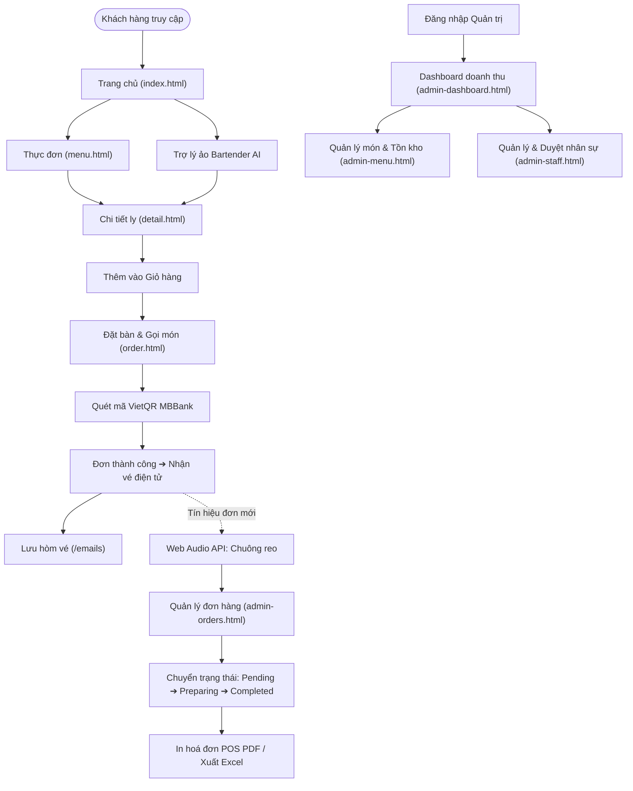

---

## 2. WORKFLOW F01: TRA CỨU, TÌM KIẾM & LỌC THỰC ĐƠN

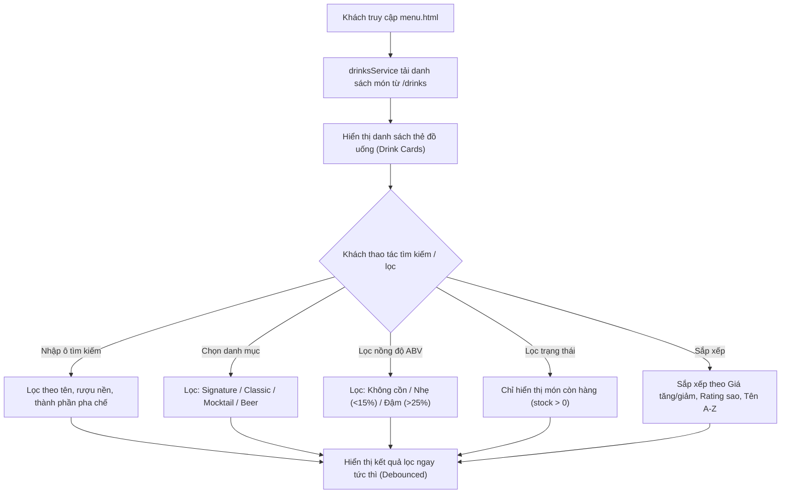

---

## 3. WORKFLOW F02: XEM CHI TIẾT LY COCKTAIL

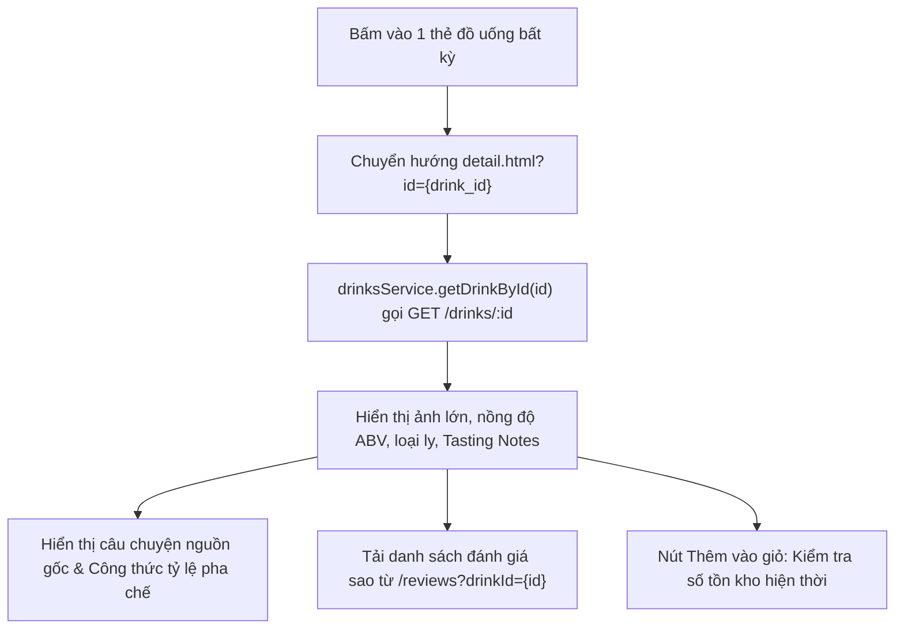

---

## 4. WORKFLOW F03: YÊU THÍCH COCKTAIL (FAVORITES)

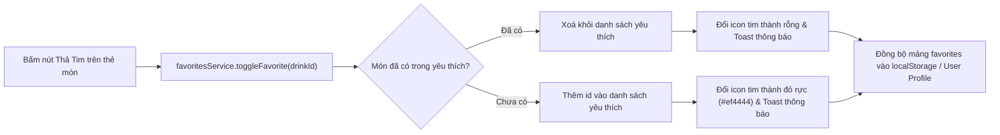

---

## 5. WORKFLOW F04: ĐÁNH GIÁ & BÌNH LUẬN 5 SAO

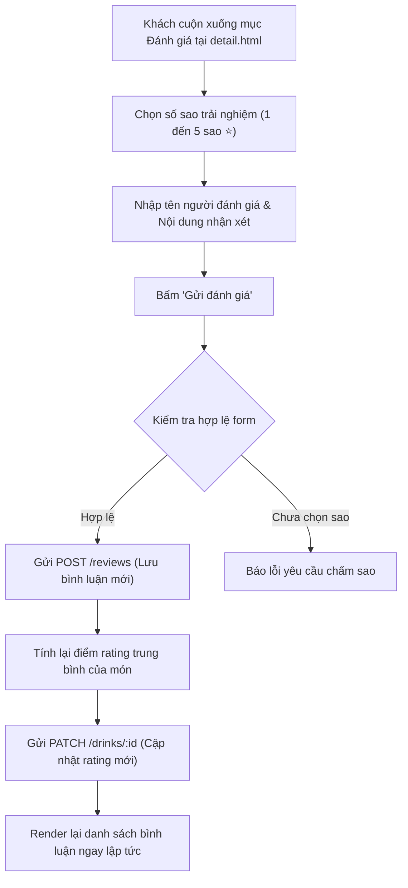

---

## 6. WORKFLOW F05: TRỢ LÝ BARTENDER ẢO AI

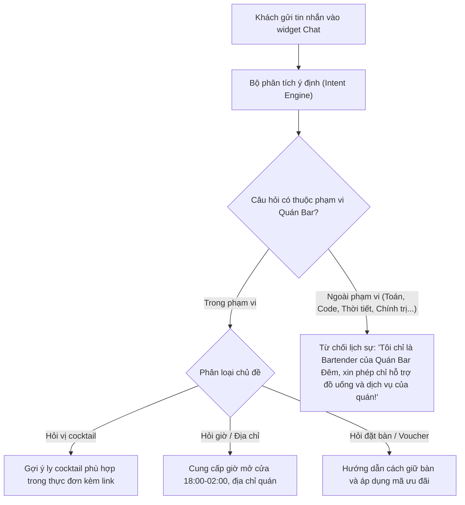

---

## 7. WORKFLOW F06: ĐẶT BÀN & CHỌN KHUNG GIỜ ĐÓN KHÁCH

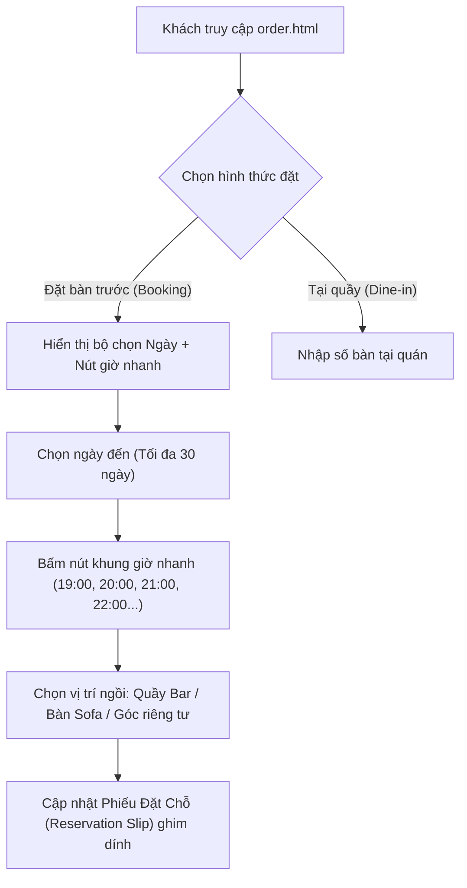

---

## 8. WORKFLOW F07: THANH TOÁN CHUYỂN KHOẢN VIETQR MBBANK

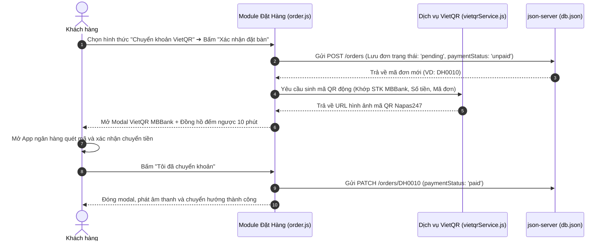

---

## 9. WORKFLOW F08: CẤP PHÁT VÉ ĐIỆN TỬ

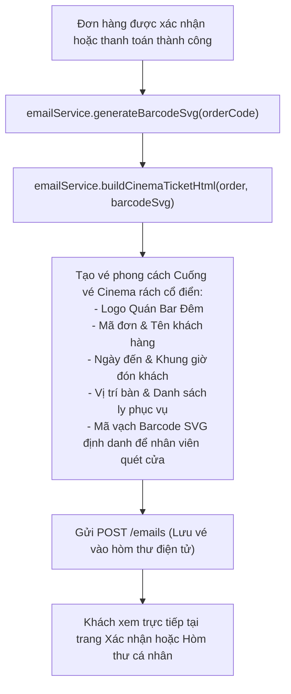

---

## 10. WORKFLOW F09: ĐĂNG NHẬP MỘT CỬA & TÍCH ĐIỂM THÀNH VIÊN

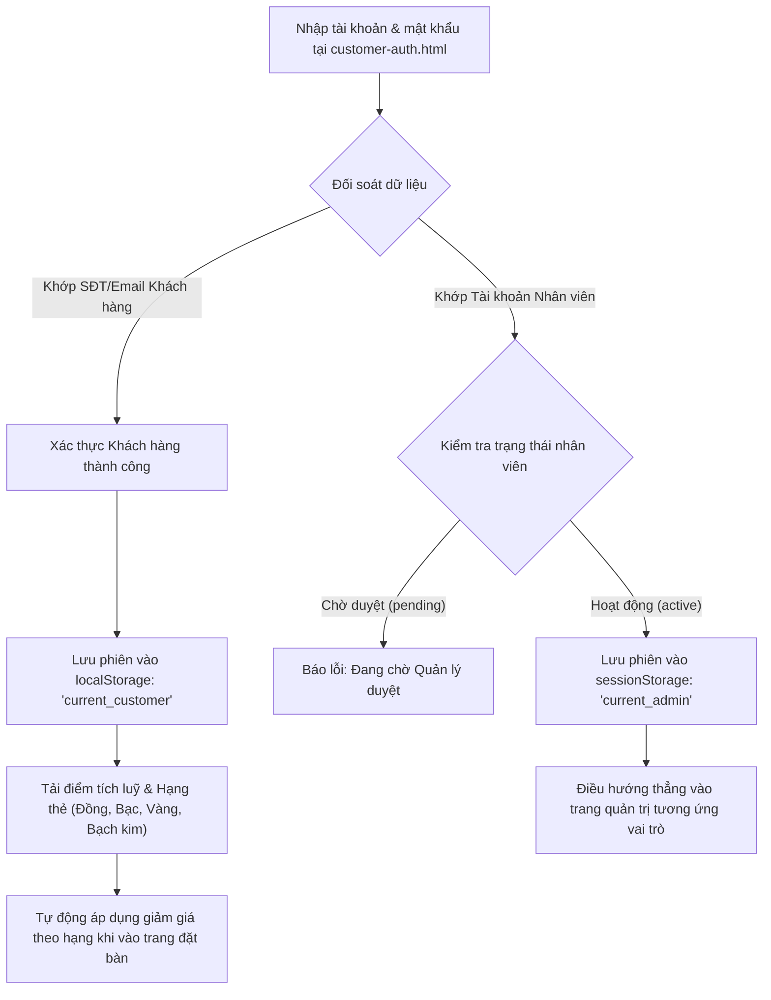

---

## 11. WORKFLOW F10: PHÂN QUYỀN VAI TRÒ NHÂN SỰ (RBAC)

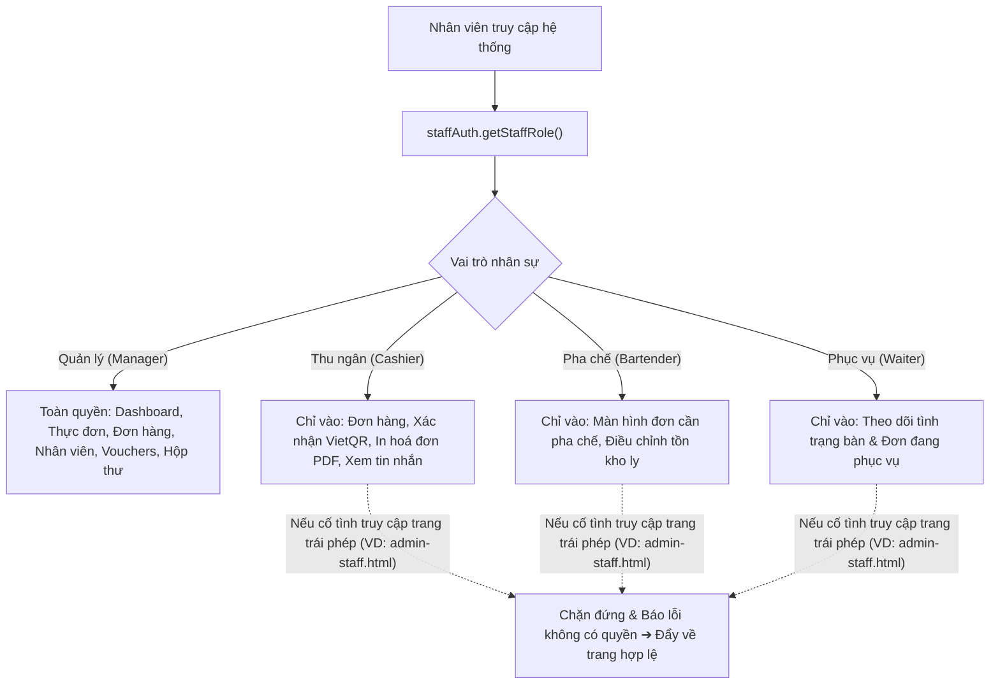

---

## 12. WORKFLOW F11: QUẢN LÝ VÒNG ĐỜI ĐƠN HÀNG & HOÀN TRỪ KHO

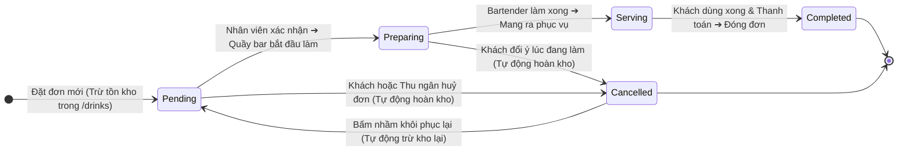

---

## 13. WORKFLOW F12: CHUÔNG ÂM THANH WEB AUDIO API THỜI GIAN THỰC

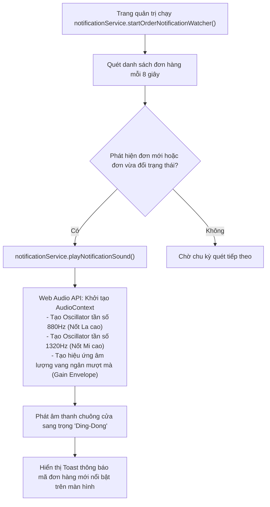

---

## 14. WORKFLOW F13: QUẢN TRỊ THỰC ĐƠN & ĐIỀU CHỈNH TỒN KHO

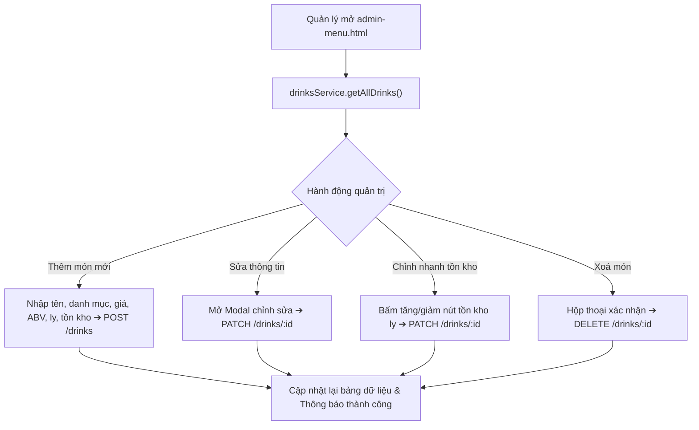

---

## 15. WORKFLOW F14: QUẢN TRỊ NHÂN SỰ & DUYỆT NHÂN VIÊN MỚI

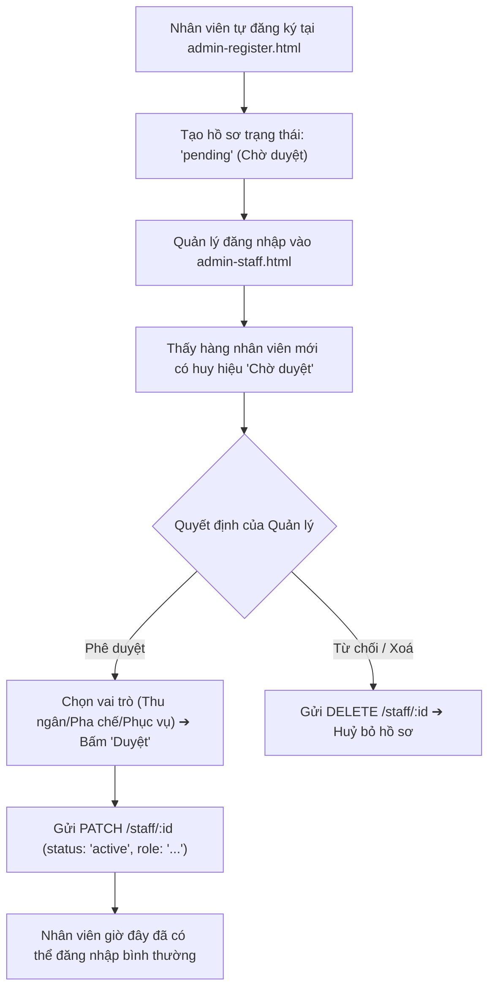

---

## 16. WORKFLOW F15: QUẢN TRỊ MÃ GIẢM GIÁ (VOUCHERS)

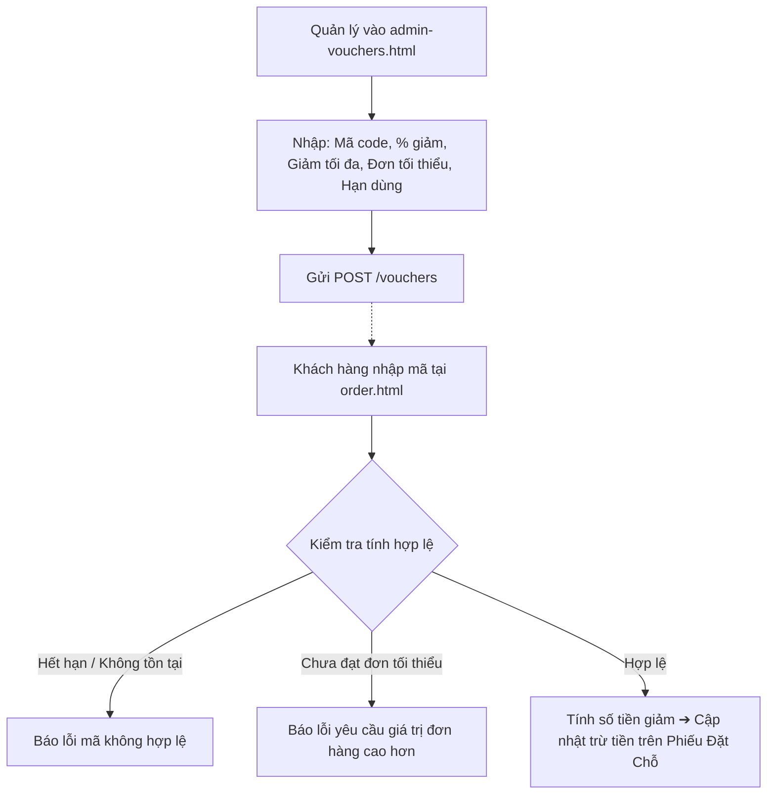

---

## 17. WORKFLOW F16: IN HÓA ĐƠN POS PDF & XUẤT BÁO CÁO EXCEL

```mermaid
flowchart TD
    AdminOrders["Thu ngân xem đơn tại admin-orders.html"] --> ChoiceDoc{"Lựa chọn thao tác"}
    
    ChoiceDoc -->|"Bấm 'In hoá đơn'"| PrintFlow["exportService.printOrderInvoice(order)"]
    PrintFlow --> FormatPOS["Định dạng phiếu in nhiệt POS 80mm:
    - Logo quán & Thông tin liên hệ
    - Mã đơn & Tên khách hàng
    - Bảng danh sách ly, đơn giá, số lượng
    - Tiền giảm voucher, thành tiền thanh toán
    - Mã QR tra cứu hoá đơn điện tử"]
    FormatPOS --> WindowPrint["Kích hoạt lệnh window.print() xuất PDF hoặc gửi máy in POS"]
    
    ChoiceDoc -->|"Bấm 'Xuất Excel'"| ExcelFlow["exportService.exportOrdersToExcel(orders)"]
    ExcelFlow --> GenerateCSV["Chuyển đổi mảng đơn hàng thành chuỗi CSV"]
    GenerateCSV --> PrependBOM["Chèn ký tự \uFEFF (UTF-8 with BOM) đầu file"]
    PrependBOM --> TriggerDownload["Tự động tải về file 'danh-sach-don-hang.csv' mở trên Excel chuẩn tiếng Việt"]
```

---

## 18. WORKFLOW F17: NHẬP THỰC ĐƠN HÀNG LOẠT TỪ FILE CSV

```mermaid
flowchart TD
    AdminMenu["Quản lý mở admin-menu.html"] --> ClickImport["Bấm nút 'Nhập CSV'"]
    ClickImport --> SelectFile["Chọn file .csv danh sách món từ máy tính"]
    SelectFile --> ParseCSV["exportService.parseCsv(fileContent)"]
    ParseCSV --> ValidateRows["Kiểm tra tính hợp lệ từng dòng: Tên món, Giá, ABV, Ly phục vụ"]
    ValidateRows --> BatchInsert["Gửi POST /drinks tuần tự thêm từng món lên máy chủ"]
    BatchInsert --> ToastResult["Hiển thị thông báo: 'Đã nhập thành công X món cocktail mới!'"]
    ToastResult --> ReloadGrid["Tự động làm mới bảng thực đơn"]
```

---

## 19. WORKFLOW F18: BẢNG ĐIỀU KHIỂN KINH DOANH THÔNG MINH (DASHBOARD)

```mermaid
flowchart TD
    OpenDash["Quản lý truy cập admin-dashboard.html"] --> FetchAll["Đồng thời tải /orders và /drinks"]
    FetchAll --> ComputeKPI["Tính toán số liệu kinh doanh:
    - Tổng doanh thu thực tế
    - Tổng số đơn đặt bàn
    - Tổng số ly cocktail đã phục vụ
    - Tỷ lệ hoàn thành đơn"]
    ComputeKPI --> RenderKPI["Hiển thị 4 thẻ KPI nổi bật trên đầu trang"]
    
    ComputeKPI --> RenderCharts["Vẽ các biểu đồ trực quan hóa:
    - Biểu đồ cột Doanh thu theo 7 ngày gần nhất
    - Biểu đồ phân bổ loại đơn (Tại quán / Đặt trước / Mang đi)
    - Danh sách Top 5 ly Cocktail bán chạy nhất (Best-Sellers)"]
```

---
*Tài liệu thuộc bộ hồ sơ kỹ thuật đồ án Quán Bar Đêm.*
